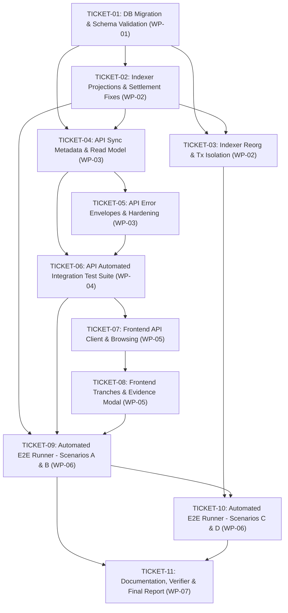

# ORAKL P1 End-to-End Implementation Tickets

**Status**: `resolved` (11 of 11 tickets resolved)
**Specification Reference**: [`.scratch/p1-e2e/spec.md`](file:///home/pupulion/orakl/.scratch/p1-e2e/spec.md)
**Target Environment**: Isolated Local Simulation (Chain ID 31337)
**Source of Truth**: `ORAKL-PRD-v1.0.md`, `ORAKL_V1_SELECTED_ECONOMICS.md`, `GLOSSARY.md`, ADR-0001 through ADR-0012

---

## 1. Ticket Inventory

| Ticket ID | Title | Work Package | Priority | Blocked By | Primary ADRs | Status |
| :--- | :--- | :--- | :--- | :--- | :--- | :--- |
| **`ORAKL-TICKET-01`** | Database Migration Deployment & Schema Validation | `WP-01` | P1 | None | ADR-0001, ADR-0005 | `resolved` |
| **`ORAKL-TICKET-02`** | Indexer Event Projection & INVALID Settlement Fixes | `WP-02` | P2 | 01 | ADR-0006, ADR-0010, ADR-0011 | `resolved` |
| **`ORAKL-TICKET-03`** | Indexer Bounded Reorg Recovery & Transactional Isolation | `WP-02` | P2 | 01, 02 | ADR-0002, ADR-0006 | `resolved` |
| **`ORAKL-TICKET-04`** | Fastify API Synchronization Metadata & Read Model Freshness | `WP-03` | P3 | 01, 02 | ADR-0001, ADR-0007 | `resolved` |
| **`ORAKL-TICKET-05`** | Fastify API Centralized Error Envelopes & Security Hardening | `WP-03` | P3 | 04 | ADR-0004, ADR-0012 | `resolved` |
| **`ORAKL-TICKET-06`** | Fastify API Automated Integration Test Suite | `WP-04` | P4 | 04, 05 | ADR-0007, ADR-0008, ADR-0012 | `resolved` |
| **`ORAKL-TICKET-07`** | Selected Frontend API Client & Market Browsing Integration | `WP-05` | P5 | 04, 06 | ADR-0007, ADR-0009 | `resolved` |
| **`ORAKL-TICKET-08`** | Selected Frontend Multi-Challenger Tranches & Evidence Modal | `WP-05` | P5 | 06, 07 | ADR-0003, ADR-0006, ADR-0011 | `resolved` |
| **`ORAKL-TICKET-09`** | Automated End-to-End Scenarios Runner: Scenarios A & B | `WP-06` | P6 | 02, 06, 08 | ADR-0008, ADR-0010, ADR-0011 | `resolved` |
| **`ORAKL-TICKET-10`** | Automated End-to-End Scenarios Runner: Scenarios C & D | `WP-06` | P6 | 03, 09 | ADR-0002, ADR-0004, ADR-0008 | `resolved` |
| **`ORAKL-TICKET-11`** | Operational Documentation, Deployment Verification & Final Evidence | `WP-07` | P7 | 09, 10 | ADR-0004, ADR-0008, ADR-0009 | `resolved` |

---

## 2. Dependency Graph

---

## 3. Execution Waves

### Wave 1: Data Precision & Schema Foundation (Immediate)
- **`ORAKL-TICKET-01`**: Deploy pending PostgreSQL migration `20261031100000_financial_columns_uint256_numeric` via `prisma migrate deploy`. Establish `NUMERIC(78,0)` precision across all financial tables.

### Wave 2: Core Ingestion & Reorg Resilience Engine
- **`ORAKL-TICKET-02`**: Fix `refundable = true` on `INVALID` settlements in `applyEvent`; align Viem struct contract read tests.
- **`ORAKL-TICKET-03`**: Fix rollback counting in `reorg.ts`; wrap ingestion cycles in strict transaction boundaries for full abort on RPC disconnection.
*Milestone Gate*: All 15 tests in `backend/test/indexer.test.ts` pass cleanly.

### Wave 3: API Standardization & Operational Security Envelope
- **`ORAKL-TICKET-04`**: Attach block synchronization metadata (`lastProcessedBlock`, `lastProcessedBlockHash`, `chainId`) to market read endpoints.
- **`ORAKL-TICKET-05`**: Enforce standardized error envelope `{ error: { code, message }, statusCode, requestId }`, redact database credentials and stack traces, and enforce strict CORS origin filtering.
- **`ORAKL-TICKET-06`**: Implement automated Vitest integration suite `backend/test/api.test.ts` covering all 18 routes with positive and negative test cases.
*Milestone Gate*: API integration test suite passes with $\ge 90\%$ branch and route coverage.

### Wave 4: Frontend Reactive Integration & Evidence Modal
- **`ORAKL-TICKET-07`**: Implement `frontend/src/selected/api-client.ts` to consume Fastify market endpoints and display indexer block lag warnings.
- **`ORAKL-TICKET-08`**: Integrate off-chain RFC 8785 evidence publishing (`POST /api/v1/evidence`) and render the M1 dispute challenger tranche ladder.
*Milestone Gate*: UI seamlessly navigates live markets, displays challenger tranches, and links verifiable evidence proofs.

### Wave 5: End-to-End Multi-Scenario Verification
- **`ORAKL-TICKET-09`**: Implement automated runner for **Scenario A** (Binary reversal with fee deduction & remainder-free challenger entitlements) and **Scenario B** (Neutral INVALID resolution with 100% refunds and zero fees).
- **`ORAKL-TICKET-10`**: Implement automated runner for **Scenario C** (Emergency pause & expired market cancellation) and **Scenario D** (10-block reorg rollback, pruning, and canonical replay).
*Milestone Gate*: Scenarios A, B, C, and D execute on local Anvil, yielding confirmed receipts and reconciled financial balances.

### Wave 6: Final Verification, Audit Evidence & Closeout
- **`ORAKL-TICKET-11`**: Execute 15 independent deployment checks, capture logs in `docs/p1/E2E_VERIFICATION.md`, document release blockers in `docs/p1/PRODUCTION_BLOCKERS.md`, and report final status: `P1 LOCAL E2E COMPLETE — PUBLIC RELEASE BLOCKED`.

---

## 4. Critical Path

$$\text{TICKET-01} \longrightarrow \text{TICKET-02} \longrightarrow \text{TICKET-03} \longrightarrow \text{TICKET-04} \longrightarrow \text{TICKET-06} \longrightarrow \text{TICKET-08} \longrightarrow \text{TICKET-09} \longrightarrow \text{TICKET-10} \longrightarrow \text{TICKET-11}$$

- Total Tickets on Critical Path: **9 of 11 tickets**.
- Minimum Sequential Steps: **6 execution waves**.

---

## 5. Risk Register

| Risk ID | Category | Risk Description | Severity | Impacted Tickets | Mitigation Strategy |
| :--- | :--- | :--- | :--- | :--- | :--- |
| **R-01** | Database | Schema drift or migration rollback failure in test environment. | High | TICKET-01 | Enforce `prisma migrate deploy` exclusively; verify precision via `information_schema.columns` (ADR-0005). |
| **R-02** | Indexer | State divergence during deep blockchain reorganisation. | High | TICKET-03, TICKET-10 | Enforce 4,096-block bounded rollback; fail closed immediately if fork depth $> 4,096$ (ADR-0002). |
| **R-03** | Financial | Floating-point rounding loss in challenger entitlement splits. | Critical | TICKET-02, TICKET-09 | Use OpenZeppelin `Math.mulDiv` on contract, `BigInt` in memory, and `NUMERIC(78,0)` in database (ADR-0001). |
| **R-04** | Security | System secret, RPC key, or database credential leak in API errors. | High | TICKET-05, TICKET-06 | Standardize error handling in `setErrorHandler`; redact internal details and attach `requestId` (ADR-0012). |
| **R-05** | Integrity | Discrepancy between frontend and backend canonical evidence hashes. | Medium | TICKET-08, TICKET-09 | Enforce RFC 8785 JCS encoding with zero JSON numbers; golden vector fixtures pass in both runtimes (ADR-0003). |
| **R-06** | Operational | Accidental interaction with or deployment to public QIE networks. | Critical | All Tickets | Gated by `LOCAL_SIMULATION` and Chain ID 31337 checks; public broadcasting prohibited (ADR-0004, ADR-0009). |

---

## 6. Acceptance Criteria Summary by Ticket

- **TICKET-01**: `prisma migrate deploy` succeeds with 0 errors; all financial columns verified as `numeric(78,0)`.
- **TICKET-02**: `refundable = true` on `INVALID` settlements; Viem struct contract reads reconciled; 2 failing tests fixed.
- **TICKET-03**: Reorg rollback count isolated per run; RPC drop executes full atomic rollback; all 15 indexer tests pass.
- **TICKET-04**: `sync.lastProcessedBlock`, `sync.lastProcessedBlockHash`, `sync.chainId` present on market read payloads.
- **TICKET-05**: Error envelopes contain `{ error: { code, message }, statusCode, requestId }`; stack traces and credentials redacted.
- **TICKET-06**: Vitest suite `backend/test/api.test.ts` covers all 18 endpoints with 100% pass rate.
- **TICKET-07**: Frontend displays markets from API, warns on $> 5$ block indexer lag, and preserves direct RPC fallback.
- **TICKET-08**: User authors and posts evidence to API; UI renders challenger tranche ladder with exact `prefixBefore`.
- **TICKET-09**: Scenarios A and B execute with confirmed Anvil transaction receipts and balanced ledger arithmetic.
- **TICKET-10**: Scenarios C and D execute with verified emergency pause cancellation and 10-block reorg recovery.
- **TICKET-11**: 15/15 deployment checks pass; operational documentation finalized without placeholder text.

---

## 7. Definition of Done (DoD) for ORAKL P1

ORAKL P1 implementation is **DONE** when and only when:
1. `prisma migrate deploy` executes cleanly with zero pending migrations.
2. All 15 tests in `backend/test/indexer.test.ts` pass without failures.
3. All Fastify API endpoints pass automated integration testing in `backend/test/api.test.ts`.
4. All 52 frontend unit tests in `frontend/test/` pass cleanly.
5. All 120 Foundry unit and invariant tests pass in `contracts/`.
6. Automated E2E runner executes Scenarios A, B, C, and D against local Anvil with confirmed transaction receipts.
7. Post-execution financial balance reconciliation proves exact equality between on-chain contract balance and database liabilities.
8. The 15 independent deployment checks in `scripts/p1/verify-local-deployment.mjs` pass cleanly.
9. All 12 ADRs are honored with zero architectural discrepancies.
10. Final execution evidence is documented in `docs/p1/` with the authorized status:
    `P1 LOCAL E2E COMPLETE — PUBLIC RELEASE BLOCKED`

---

## 8. Consistency Review against 12 ADRs and Approved Specification

- **ADR-0001 (NUMERIC(78,0) uint256)**: Fully addressed in TICKET-01, TICKET-02, TICKET-04.
- **ADR-0002 (Bounded Reorg Rollback 4096)**: Fully addressed in TICKET-03, TICKET-10.
- **ADR-0003 (RFC 8785 Canonical Evidence)**: Fully addressed in TICKET-08, TICKET-09.
- **ADR-0004 (Local Simulation Boundary 31337)**: Enforced across all tickets.
- **ADR-0005 (Prisma Migrate Deploy)**: Fully addressed in TICKET-01.
- **ADR-0006 (Atomic Multi-Challenger Tranches)**: Fully addressed in TICKET-02, TICKET-03, TICKET-08.
- **ADR-0007 (API Synchronization Metadata)**: Fully addressed in TICKET-04, TICKET-07.
- **ADR-0008 (Verification Test Gates)**: Fully addressed in TICKET-06, TICKET-09, TICKET-10, TICKET-11.
- **ADR-0009 (Environment Segregation & Legacy Preservation)**: Enforced in TICKET-07, TICKET-11.
- **ADR-0010 (Refundable Creator Bond K, F = 0)**: Fully addressed in TICKET-02, TICKET-09.
- **ADR-0011 (Neutral Refund Policy & Integer Claims)**: Fully addressed in TICKET-02, TICKET-08, TICKET-09.
- **ADR-0012 (Centralized Fastify Error Envelope)**: Fully addressed in TICKET-05, TICKET-06.
