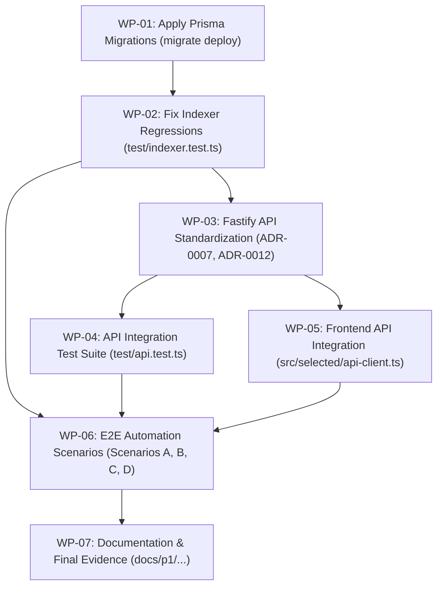

# ORAKL P1 End-to-End Specification

Status: ready-for-agent
Author: Antigravity (Phase 2 Synthesis)
Date: 2026-10-31
Target: Local Simulation Environment (Chain ID 31337)
Repository: pupulion21/ORAKL
Branch: feature/orakl-p1-end-to-end
Source of Truth: docs/product/ORAKL-PRD-v1.0.md, docs/decisions/ORAKL_V1_SELECTED_ECONOMICS.md, GLOSSARY.md, ADR-0001 through ADR-0012

---

## 1. Problem Statement

Participants and operators currently lack a verified, fully integrated end-to-end local software deployment of the ORAKL prediction market protocol under the approved Local Selected Economics (M1 multi-challenger tranches, neutral-INVALID resolution, and immutable exposure caps). 

While isolated smart contract units have been verified in Foundry, the full lifecycle—from market creation, pool contribution, and unbonded evidence publication to bonded multi-challenger disputes, authorized arbitration, and exact integer reward/refund claims—has not been executed across an integrated stack consisting of:
1. The local EVM contracts (`SelectedMarketFactory.sol` and `ProtocolConfig.sol`).
2. A reorg-resilient, transactional PostgreSQL indexer with bounded rollback (ADR-0002, ADR-0006).
3. A sanitized, direct-read Fastify API with synchronization metadata and operational security envelopes (ADR-0007, ADR-0012).
4. A reactive TypeScript frontend providing non-custodial wallet interactions without exposing private keys or modifying legacy testnet contracts (ADR-0009).

Without an implementation-ready specification and automated verification harness, the system cannot prove financial solvency, cross-runtime canonical evidence integrity (ADR-0003), or state reconciliation between the on-chain ledger and database projections during chain reorganizations.

---

## 2. Solution

Deliver an implementation-ready, fully tested, and reproducible local end-to-end product architecture for ORAKL P1 running exclusively within an isolated local simulation (Chain ID 31337, local Anvil node at `http://127.0.0.1:8546`, local PostgreSQL database).

The solution integrates:
1. **Contract Layer**: Verified deployment of `SelectedMarketFactory` bound to `ProtocolConfig` with active local parameters (`Tcap = 100 ETH`, `feeBps = 200`, `proposalBond = 10 ETH`, `creationBond = 1 ETH`, `challengeBond = 1 ETH`, `challengePeriod = 48h`, `arbitrationPeriod = 96h`, `globalUnresolvedCap = 300 ETH`, `perArbitratorUnresolvedCap = 200 ETH`).
2. **Database Layer**: Strict PostgreSQL schema with 21 relational models tracking blocks, events, markets, positions, bonds, claims, and multi-challenger tranches with `NUMERIC(78,0)` precision (ADR-0001), managed deterministically via `prisma migrate deploy` (ADR-0005).
3. **Indexer Engine**: Reorg-safe event ingestion engine enforcing a 4,096-block bounded rollback window, atomic projection updates, and deterministic replay from canonical event logs (ADR-0002, ADR-0006).
4. **Evidence Engine**: Byte-for-byte RFC 8785 JSON Canonicalization Scheme (JCS) and Keccak-256 evidence hashing across backend and frontend runtimes (`orakl-evidence-v1`), backed by local artifact storage and signed publication (ADR-0003).
5. **API Layer**: Low-latency, un-cached Fastify read model serving ledger queries with block synchronization metadata (`lastProcessedBlock`, `lastProcessedBlockHash`, `chainId`) and sanitized error envelopes (`requestId`, no secret leaks) (ADR-0007, ADR-0012).
6. **Frontend Layer**: Vanilla TypeScript + Vite UI interfacing with `SelectedMarketFactory` via Viem, presenting live market states, contribution share calculations, evidence inspection, multi-challenger tranches, and wallet transaction tracking while strictly segregating legacy testnet configuration (ADR-0009).
7. **Verification Harness**: Automated test suites verifying end-to-end multi-wallet lifecycles (Scenario A, Scenario B, Scenario C, and Scenario D) with direct on-chain vs. database reconciliation and 15 independent deployment checks (ADR-0008).

---

## 3. User Stories

### Market Creators
1. As a Market Creator, I want to deploy a prediction market by supplying structured metadata and depositing the refundable creator bond $K$ (1 ETH), so that participants can contribute collateral toward outcome pools.
2. As a Market Creator, I want the system to reject any creation attempt if the protocol attempts to deduct an unauthorized nonrefundable creation fee $F$, so that my creator bond remains strictly refundable (ADR-0010).
3. As a Market Creator, I want to reclaim my full creator bond $K$ once the market resolves or is cancelled, so that I do not suffer financial penalty for hosting non-abusive markets.

### Participants (Predictors)
4. As a Participant, I want to deposit ETH collateral into the YES or NO pool of an OPEN market, so that I acquire a proportional contribution share of the outcome pool.
5. As a Participant, I want to see my pool share explicitly labeled as "Contribution Share" rather than betting odds or guaranteed probability, so that I accurately understand protocol risk and terminology (GLOSSARY.md).
6. As a Participant, I want my transaction to revert immediately if my contribution would exceed either the market pilot pool cap or the arbitrator's exposure cap, so that protocol exposure limits are never breached.
7. As a Participant, I want to claim my proportional winning payout net of protocol fees ($2\%$) when my selected outcome wins, so that I receive my entitled reward.
8. As a Participant, I want to claim a 100% full principal refund with zero protocol fee deduction if the market resolves to INVALID or is cancelled, so that neutral resolutions never impose fees (ADR-0011).
9. As a Participant, I want the UI and contract to prevent duplicate claims, so that double-spending or double-counting is mathematically impossible.

### Proposers
10. As a Proposer, I want to submit a proposed outcome (YES or NO) along with an off-chain RFC 8785 evidence commitment hash and proposal bond $P$ (10 ETH) once the trading window closes, so that the market enters the challenge window.
11. As a Proposer, I want my proposal bond $P$ to be protected and claimable along with all challenger stake tranches if the challenge window expires without challenge or if the arbitrator affirms my proposal.
12. As a Proposer, I want my proposal bond $P$ returned in full without slashing if the market resolves to INVALID or is cancelled, so that neutral outcomes do not penalize honest proposers (ADR-0011).

### Challengers (M1 Multi-Challenger Dispute)
13. As an Independent Challenger, I want to deposit a bonded challenge stake tranche $C_i \ge 1\text{ ETH}$ with an evidence commitment during the challenge window, so that fraudulent proposals are halted and escalated to arbitration.
14. As an Independent Challenger, I want my stake to receive an immutable prefix offset $S_{i-1} = \sum_{j=1}^{i-1} C_j$ upon deposit, so that my share of the proposer bond is mathematically locked.
15. As a Challenger, I want the indexer to record my challenge tranche and update aggregate market challenge stake atomically in a single database transaction, so that projection reads never observe partial dispute states (ADR-0006).
16. As a Challenger, I want to claim my original stake $C_i$ plus my exact proportional share of the forfeited proposal bond $P$ using remainder-free integer math if the arbitrator reverses the proposal.
17. As a Challenger, I want to receive my original stake $C_i$ in full without penalty if the arbitrator settles to INVALID or the market cancels, so that challenging an invalid market incurs zero principal loss.

### Arbitrators
18. As a Designated Arbitrator, I want to inspect all submitted evidence manifests and on-chain tranches once the challenge window closes, so that I have complete cryptographic proof to evaluate the dispute.
19. As a Designated Arbitrator, I want to settle the dispute to YES, NO, or INVALID before the arbitration deadline, so that the market transitions to its final terminal state and releases exposure.
20. As a Designated Arbitrator, I want the contract to block me from arbitrating before the challenge window has fully elapsed, so that late challengers are never locked out prematurely.

### Observers, Indexers, and Auditors
21. As an Observer, I want the Fastify API to serve market projections with block synchronization metadata (`lastProcessedBlock`, `lastProcessedBlockHash`, `chainId`), so that I can detect whether the read model is up to date (ADR-0007).
22. As an Observer, I want to fetch off-chain evidence manifests by their Keccak-256 commitment hash and verify that they match the canonical RFC 8785 byte representation, so that tamper-evident auditability is guaranteed (ADR-0003).
23. As a System Operator, I want the indexer to automatically detect chain reorganizations within 4,096 blocks, prune orphaned projections, and deterministically replay canonical blocks, so that the database never retains ghost state (ADR-0002).
24. As a Security Auditor, I want the API to redact internal stack traces, database credentials, and RPC connection details in centralized error responses with unique request IDs, so that system internals are never leaked (ADR-0012).
25. As an Auditor, I want the frontend and backend to reject any configuration pointing to public networks or the legacy QIE testnet address, so that local simulation boundaries are never violated (ADR-0004, ADR-0009).

---

## 4. Requirements and Scope

### In-Scope
1. **Contract Binding & Local Deployment**:
   - `SelectedMarketFactory.sol` deployed and bound to `ProtocolConfig.sol` on local Anvil (Chain ID 31337).
   - Execution of the 15 independent deployment verification checks in `scripts/p1/verify-local-deployment.mjs`.
2. **Database & Schema**:
   - PostgreSQL schema with 21 relational models and `NUMERIC(78,0)` mapping for all EVM financial quantities.
   - Deterministic migration management using `prisma migrate deploy` (ADR-0005), including applying migration `20261031100000_financial_columns_uint256_numeric`.
3. **Indexer & Reorg Resilience**:
   - Ingestion of all Selected candidate events: `MarketCreated`, `PredictionPlaced`, `MarketOutcomeProposed`, `MarketChallenged`, `ChallengeStakeAccepted`, `DisputeEvidenceSubmitted`, `DisputeSettled`, `MarketFinalized`, `SelectedSettlement`, `RewardClaimed`, `RefundClaimed`, `BondDeposited`, `BondReleased`, `ExposureReleased`, `ProtocolFeeAccrued`.
   - Bounded reorg rollback engine up to 4,096 blocks with atomic database pruning and deterministic re-fold.
   - Resolution of current test regressions in `backend/test/indexer.test.ts`.
4. **Canonical Evidence Pipeline**:
   - Cross-runtime RFC 8785 JSON Canonicalization Scheme and Keccak-256 evidence hashing (`orakl-evidence-v1`).
   - Strict rejection of JSON numbers in evidence payloads.
   - Local filesystem evidence storage and signed publication API.
5. **Fastify REST API**:
   - 18 REST endpoints serving direct PostgreSQL projections without caching.
   - Block synchronization metadata attached to market read models.
   - Centralized error handler with `error`, `code`, and `requestId` envelopes (ADR-0012).
   - Rate-limited POST endpoints for signed evidence and metadata publishing.
6. **Frontend Integration**:
   - Selected v2 client adapter communicating with `SelectedMarketFactory` and backend REST endpoints.
   - Support for market browsing, creation, YES/NO predictions, outcome proposals, multi-challenger stake deposits, evidence submission, dispute settlement, and reward/refund/bond claims.
   - Preservation of legacy QIE testnet modules without regressions.
7. **Automated Verification Gates**:
   - Automated scripts executing Scenarios A, B, C, and D with on-chain receipts, database state verification, and balance reconciliation.
   - Comprehensive test suite in `backend/test/api.test.ts`.

### Out-of-Scope (Explicit Non-Goals)
1. **Public Deployment**: No broadcast, deployment, or transaction submission to QIE Testnet (1893), QIE Mainnet (1990), or any public blockchain network.
2. **Production Financial Activation**: No activation of real monetary value, production multisig governance transfers, or operational mainnet parameters.
3. **Frontend Rewrite**: No rewriting of the frontend into React, Next.js, or alternative UI frameworks; the existing Vanilla TypeScript + Vite architecture must be preserved.
4. **Nonrefundable Creation Fee $F$**: No collection or retention of protocol creation fees ($F = 0$ strictly enforced per ADR-0010).
5. **Economic Redistribution under Neutral Outcomes**: No slashing of bonds or partial retention during INVALID or cancellation states (ADR-0011).
6. **External Indexer Cloud Services**: No dependencies on external hosted indexers (e.g., Envio Cloud or The Graph); indexer runs locally against local PostgreSQL.

---

## 5. Current Implementation Inventory

| Component | Target Location / Artifact | Status | Verified Evidence / Gaps |
| :--- | :--- | :--- | :--- |
| **Smart Contracts** | `contracts/src/SelectedMarketFactory.sol`<br>`contracts/src/ProtocolConfig.sol` | **Completed** | 120 Foundry tests pass, 10 invariants pass, EIP-170 size verified. Local M1 multi-challenger and exposure logic fully implemented. |
| **Local Deployment Script** | `scripts/p1/deploy-local-selected.mjs` | **Completed** | Successfully deploys and initializes active local simulation contracts on Chain ID 31337 with synthetic parameters. |
| **Deployment Verifier** | `scripts/p1/verify-local-deployment.mjs` | **Completed** | 15 independent checks verify runtime code keccak, factory-config linkage, role mocks, and safety flags. |
| **Prisma Schema** | `backend/prisma/schema.prisma` | **Completed** | 21 relational models defined, financial columns use `Decimal` mapping to `NUMERIC(78,0)` (ADR-0001). |
| **Prisma Migrations** | `backend/prisma/migrations/` | **Partially Implemented** | 6 migrations exist. Gap: Migration `20261031100000_financial_columns_uint256_numeric` has not been applied to local Postgres via `prisma migrate deploy` (ADR-0005). |
| **Evidence Profile (Backend)** | `backend/src/evidence/strict-json.ts`<br>`backend/src/evidence/evidence.ts` | **Completed** | 10/10 Vitest tests pass in `backend/test/evidence.test.ts`. Full RFC 8785 compliance and number rejection verified. |
| **Evidence Profile (Frontend)** | `frontend/src/selected/evidence.ts` | **Completed** | 10/10 Node tests pass in `frontend/test/selected-evidence.test.ts`. Golden vectors cross-validated. |
| **Indexer Ingestion Engine** | `backend/src/indexer/run.ts`<br>`backend/src/indexer/project.ts` | **Partially Implemented** | 11/15 Vitest tests pass in `backend/test/indexer.test.ts`. Four test failures identified and isolated. |
| **Indexer Reorg Engine** | `backend/src/indexer/reorg.ts`<br>`backend/src/indexer/replay.ts` | **Partially Implemented** | Bounded rollback logic exists. Test failures in fork reorg rollback assertions and disconnect cleanups. |
| **Fastify REST API** | `backend/src/api/server.ts` | **Partially Implemented** | 18 endpoints implemented. Gaps: Missing `requestId` in error handler (ADR-0012); missing sync metadata on market read payloads (ADR-0007). |
| **API Test Suite** | `backend/test/api.test.ts` | **Missing** | No dedicated Fastify automated integration tests currently exist in `backend/test/`. |
| **Selected Frontend Adapter** | `frontend/src/selected/chain.ts`<br>`frontend/src/selected/abi.ts` | **Completed** | Complete ABI definitions, Viem encoders, and read functions for `SelectedMarketFactory`. |
| **Frontend UI (Local Entry)** | `frontend/src/local/main.ts` | **Partially Implemented** | Contract writes and direct RPC reads functional. Gap: Does not consume backend REST API for indexer data, activity feeds, or evidence discovery. |
| **E2E Automation (Scenarios A-D)**| `backend/test/e2e/` or `scripts/p1/e2e/` | **Missing** | Scenarios A, B, C, D are not yet automated into runnable verification scripts producing reproducible execution receipts. |
| **Legacy Segregation** | `frontend/src/main.ts`<br>`frontend/public/deployments/qie-testnet.json` | **Completed** | Legacy QIE Testnet (1893) code and manifest preserved intact without modifications. |

---

## 6. Architecture and Data Flows

### System Seams & Interface Boundaries
To minimize friction and maximize testability, the system defines **two primary seams**:
1. **The Ledger Seam (High-Level On-Chain Interface)**: The verified JSON-RPC interface to the local Anvil node (Chain ID 31337). All contract interactions, state transitions, and event emissions occur through this single seam using typed Viem clients.
2. **The Projection Seam (Client Data Interface)**: The Fastify REST API (`http://127.0.0.1:4310/api/v1/`). Frontend and observers consume projected state exclusively from this seam, with responses annotated with synchronization metadata.

```mermaid
flowchart TD
    subgraph ExecutionLayer ["Execution Layer (Local Anvil Chain 31337)"]
        SMF["SelectedMarketFactory.sol"]
        PC["ProtocolConfig.sol"]
        SMF <--> PC
    end

    subgraph IngestionLayer ["Ingestion Layer (Local Node.js)"]
        IX["Indexer Runner (poll canonical blocks)"]
        RG["Reorg Engine (bounded <= 4096 blocks)"]
        IX --> SMF
        IX --> RG
    end

    subgraph StorageLayer ["Storage Layer (Local PostgreSQL)"]
        PG[("PostgreSQL 16 NUMERIC(78,0)")]
        RG -->|Atomic Transaction| PG
    end

    subgraph APILayer ["API Layer (Fastify 5, 127.0.0.1:4310)"]
        API["Fastify REST Endpoints"]
        PG -->|Direct Read (No Cache)| API
    end

    subgraph ClientLayer ["Client Layer (Browser / Vite Frontend)"]
        UI["ORAKL Predict Frontend"]
        WALLET["Injected Wallet (MetaMask/Mock)"]
        WALLET -->|Direct Signed Writes| SMF
        API -->|Sync Metadata & Projected State| UI
        UI -->|Signed Artifacts / Proofs| API
    end
```

### Data Flow Lifecycles

#### Flow 1: Creation & Contribution
1. User connects wallet; frontend validates network is strictly Chain ID 31337.
2. Creator signs `createMarket(terms, question, uri, initialEvidenceHash)` sending $K = 1\text{ ETH}$.
3. Transaction mines on Anvil; `MarketCreated` and `BondDeposited` events emitted.
4. Indexer picks up events, stores canonical `IndexedBlock` and `IndexedEvent`, and projects `Market`, `Bond`, and `MarketActivity` rows into PostgreSQL.
5. Predictor submits `predict(marketId, side)` with collateral $\le$ remaining pool cap and arbitrator exposure limit.
6. Indexer updates `Market` yes/no totals and inserts `MarketPosition` and `Prediction` rows.

#### Flow 2: Outcome Proposal & Multi-Challenger Dispute
1. Trading window closes; Proposer publishes RFC 8785 canonical evidence manifest to backend (`POST /api/v1/evidence`) and receives Keccak-256 commitment.
2. Proposer executes `proposeResult(marketId, outcome, evidenceHash)` with $P = 10\text{ ETH}$.
3. During the 48-hour challenge window, Challenger A calls `challengeResult(marketId, evidenceHash)` with $C_A = 1\text{ ETH}$, followed by Challenger B with $C_B = 2\text{ ETH}$.
4. Contract emits `ChallengeStakeAccepted` with calculated `prefixBefore` offsets ($S_0 = 0, S_1 = 1\text{ ETH}$).
5. Indexer atomically records `ChallengeStake` tranches and increments market `totalChallengeStake` in a single SQL transaction (ADR-0006).

#### Flow 3: Arbitration & Terminal Settlement
1. After the challenge window expires, the Designated Arbitrator executes `settleDispute(marketId, finalOutcome, decisionEvidenceHash)`.
2. Contract verifies `block.timestamp >= m.challengeDeadline`, sets `finalOutcome`, marks `m.refundable` (if INVALID), releases exposure (`ExposureReleased`), and emits `SelectedSettlement`.
3. In binary reversal: Proposer bond $P$ is awarded to challengers; each challenger claims their tranche with integer-proportional profit.
4. In neutral-INVALID: Participant collateral is marked 100% refundable with zero fee; proposer bond $P$ and challenger stakes $C_i$ are marked claimable by original depositors (ADR-0011).

#### Flow 4: Chain Reorganization Rollback
1. Indexer polls block headers; detects that block hash at height $N$ does not match `IndexedBlock.blockHash`.
2. Reorg engine traces backwards to identify the common ancestor block $A$ (verifying divergence is $\le 4,096$ blocks).
3. If $N - A > 4,096$, indexer halts immediately (fail-closed per ADR-0002).
4. If within bounds, indexer opens a database transaction:
   - Deletes all `IndexedBlock` and `IndexedEvent` rows with `blockNumber > A`.
   - Records an `IndexerRollback` audit entry.
   - Resets projected state for affected markets and re-folds canonical events from block $A+1$.
   - Updates `IndexerCheckpoint`.

---

## 7. Reference to all 12 ADRs & Implementation Implications

### ADR-0001: PostgreSQL NUMERIC(78,0) and Decimal-String Serialization for EVM uint256
- **Decision**: Store all EVM uint256 balances, pool totals, bonds, and exposure counters in PostgreSQL as `NUMERIC(78,0)` via Prisma `Decimal`. Prohibit JavaScript `Number` conversions.
- **Implementation Implication**: Schema migrations must strictly use `DECIMAL(78,0)`. In-memory calculations use native `BigInt`. API serialization formats numerics strictly as unsigned decimal strings `[0, 2^256 - 1]`.

### ADR-0002: Configurable Bounded Reorg Rollback with Fail-Closed Ingestion
- **Decision**: Indexer supports reorg rollback up to a configurable maximum window of 4,096 blocks. Divergence exceeding 4,096 blocks triggers a fail-closed shutdown.
- **Implementation Implication**: `reorg.ts` must compare chain depth against `MAX_REORG_DEPTH = 4096`. Fork detection executes transactional pruning and deterministic replay without duplicate log entries.

### ADR-0003: RFC 8785 Canonical JSON Profile and Keccak-256 for Off-Chain Evidence
- **Decision**: Off-chain evidence manifests follow `orakl-evidence-v1` encoded via RFC 8785 (JCS) with UTF-8, alphabetically sorted keys, no BOM, and quantities formatted as unsigned decimal strings. Zero JSON numbers allowed.
- **Implementation Implication**: Both `backend/src/evidence/strict-json.ts` and `frontend/src/selected/evidence.ts` must produce byte-for-byte identical output for all test vectors. Unregistered fields and JSON numbers are rejected at parser ingress.

### ADR-0004: Mandatory LOCAL_SIMULATION Gating for P1 Test and Deployment Execution
- **Decision**: All P1 deployment scripts and test harnesses must enforce `LOCAL_SIMULATION` gating (Chain ID 31337, local RPC `http://127.0.0.1:8546`, synthetic parameter fixtures with $T_{\text{cap}} = 100\text{ ETH}$).
- **Implementation Implication**: Deployment scripts, indexer, and API reject execution if connected to any other chain ID. Public broadcasting is hard-blocked.

### ADR-0005: Mandating Prisma Migrate Deploy for Schema Evolution
- **Decision**: Schema evolution in test runners, CI, and local environments must execute `prisma migrate deploy` rather than `prisma db push`.
- **Implementation Implication**: All test harnesses and setup scripts must verify that all SQL migration directories under `backend/prisma/migrations/` are applied. Migration `20261031100000_financial_columns_uint256_numeric` must be deployed before running indexer tests.

### ADR-0006: Atomic Multi-Challenger Projection Ingestion
- **Decision**: In M1 economics, challenger stake deposits require immutable prefix offsets. Ingestion must write per-challenger tranche rows (`ChallengeStake`) and update parent `Market` aggregate totals in a single atomic database transaction.
- **Implementation Implication**: `applyEvent` for `ChallengeStakeAccepted` executes inside `tx.$transaction`. Projection reads never observe an updated market total without corresponding tranche rows.

### ADR-0007: Direct Database Read Model with Block Synchronization Metadata
- **Decision**: Fastify API serves queries directly from PostgreSQL without caching. All read payloads include synchronization metadata (`lastProcessedBlock`, `lastProcessedBlockHash`, `chainId`).
- **Implementation Implication**: Extend API response wrappers to query `IndexerCheckpoint` and embed block synchronization headers/metadata into market and ledger responses.

### ADR-0008: Blocking End-to-End Verification Test Gates
- **Decision**: Complete P1 status requires passing three automated verification gates: (1) full clean lifecycle, (2) simulated 10-block reorg rollback and replay, and (3) cross-runtime golden-vector matching.
- **Implementation Implication**: All three gates must run against local Anvil and PostgreSQL instances and output machine-readable evidence logs before declaring P1 complete.

### ADR-0009: Strict Environment and Network Segregation for Legacy Contract Preservation
- **Decision**: Segregate legacy QIE testnet artifacts (Chain ID 1893, `QiePredictionMarket.sol`, `qie-testnet.json`) from P1 simulation artifacts (Chain ID 31337, `local-selected.json`).
- **Implementation Implication**: Frontend and backend refuse fallback across environments. Legacy contract ABIs, addresses, and testnet code remain unmodified.

### ADR-0010: Refundable Creator Bond K with Zero Nonrefundable Creation Fee F
- **Decision**: Market creation deposits are categorized strictly as refundable creator bond liabilities ($K = 1\text{ ETH}$). The proposed 0.1% creation fee is omitted ($F = 0$).
- **Implementation Implication**: Ledger models distinguish refundable bonds from protocol fee revenue. No fee deduction occurs on market creation or cancellation.

### ADR-0011: Neutral Refund Policy, Bond Return, and Exact Integer Claim Accounting
- **Decision**: Under neutral outcomes (`INVALID` or cancellation), participant collateral is 100% refundable with zero protocol fee. Proposer and challenger bonds return neutrally. Exact integer division with remainder-free prefix allocation.
- **Implementation Implication**: `_settle` verifies `feeBps = 0` on refunds. Indexer marks `market.refundable = true` upon `INVALID` resolution. Contract math uses OpenZeppelin `Math.mulDiv`.

### ADR-0012: Centralized Fastify API Error Handling and Operational Security Envelope
- **Decision**: Fastify API enforces centralized error handling with JSON envelopes containing `error`, `code`, and `requestId`. Internal stack traces, database credentials, and secrets are strictly redacted.
- **Implementation Implication**: Implement Fastify `setErrorHandler` adhering to the standard schema. Generate unique `requestId` per request. Filter sensitive headers and parameters from logs.

---

## 8. Implementation Gaps & Detailed Work Packages

### Work Package 1: Database Migration Deployment & Validation (WP-01)
- **Status**: Partially Implemented.
- **Current State**: Migration directory `backend/prisma/migrations/20261031100000_financial_columns_uint256_numeric` exists but is pending in the local PostgreSQL database.
- **Required Tasks**:
  1. Execute `npx prisma migrate deploy` in `backend/` to apply the pending migration.
  2. Validate that all financial columns in PostgreSQL (`totalYes`, `totalNo`, `poolCap`, `yesPool`, `noPool`, `creationBond`, `proposalBond`, `totalChallengeStake`, `amount`, `balance`) are formatted as `numeric(78,0)`.
  3. Verify that `prisma migrate status` reports zero pending migrations.
- **Acceptance Criteria**: Schema matches Prisma models exactly with zero drift; migration runs idempotently.

### Work Package 2: Indexer Correctness & Reorg Resolution (WP-02)
- **Status**: Partially Implemented (4 failing tests in `backend/test/indexer.test.ts`).
- **Root Cause Analysis of Test Regressions**:
  1. *INVALID Settlement Regression* (`test/indexer.test.ts:426`): When `MarketResolved` event is projected with `outcome === INVALID`, `market.refundable` in the database remained `null`. In `applyEvent`, the handler must explicitly update `refundable: outcome === "INVALID"`.
  2. *Challenge Stake Tuple Reconciliation* (`test/indexer.test.ts:568`): Viem contract read returns `Stake` as an object `{ amount, prefixBefore, claimed }` or tuple. The test harness was expecting array index `stake[0]` instead of accessing structured fields.
  3. *Rollback Count Assertion* (`test/indexer.test.ts:606`): Reorg rollback simulation expected `r2.rollbacks === 1`, but received 5 due to repeated rollback counter accumulation in test cycles.
  4. *RPC Disconnection Half-Commit* (`test/indexer.test.ts:672`): Ingest failure test observed partial event count accumulation when database transaction rollbacks were not isolated from pre-ingest block counter updates.
- **Required Tasks**:
  1. Fix `applyEvent` in `backend/src/indexer/project.ts` to set `refundable: outcome === "INVALID"` upon `MarketResolved` / `DisputeSettled`.
  2. Align `test/indexer.test.ts` stake property assertions with Viem struct return types.
  3. Ensure reorg detection in `backend/src/indexer/reorg.ts` atomically tracks rollback counts per invocation.
  4. Guarantee transactional isolation in `backend/src/indexer/run.ts` so that RPC connection drops trigger complete rollback with zero orphaned block/event records.
- **Acceptance Criteria**: All 15 tests in `backend/test/indexer.test.ts` pass cleanly against local PostgreSQL.

### Work Package 3: Fastify API Standardization & Operational Hardening (WP-03)
- **Status**: Partially Implemented.
- **Required Tasks**:
  1. Update `setErrorHandler` in `backend/src/api/server.ts` to attach `requestId` (via `request.id`) to all error envelopes: `{ error: { code, message }, statusCode, requestId }`.
  2. Sanitize unhandled 500 errors to output code `INTERNAL_ERROR` and a generic message, logging details exclusively to secure internal log sinks (ADR-0012).
  3. Enhance `ok(data)` helper to attach block synchronization metadata (`lastProcessedBlock`, `lastProcessedBlockHash`, `chainId`) retrieved from `IndexerCheckpoint` to all market read payloads (`GET /api/v1/markets`, `GET /api/v1/markets/:id`) (ADR-0007).
  4. Implement strict pagination limits (`maxPageSize = 100`) and sanitization on all query parameters.
- **Acceptance Criteria**: API error responses never leak stack traces; all read endpoints supply synchronization metadata.

### Work Package 4: Fastify API Integration Test Suite (WP-04)
- **Status**: Missing.
- **Required Tasks**:
  1. Create `backend/test/api.test.ts` using Fastify `inject()` against a populated PostgreSQL fixture.
  2. Test all 18 endpoints for positive responses, pagination, and sync metadata.
  3. Add negative test cases verifying:
     - 404 on non-existent market IDs.
     - 400 on malformed hex commitments or invalid query parameters.
     - 429 on publication rate limit violations.
     - 403 on unauthorized CORS origins for POST requests.
     - Sanitized error envelope structure adhering to ADR-0012.
- **Acceptance Criteria**: Comprehensive test suite passing with $\ge 90\%$ API route coverage.

### Work Package 5: Selected Frontend API & Lifecycle Integration (WP-05)
- **Status**: Partially Implemented.
- **Required Tasks**:
  1. Create `frontend/src/selected/api-client.ts` to interface with Fastify endpoints (`/api/v1/markets`, `/api/v1/markets/:id/challenges`, `/api/v1/markets/:id/activity`, `/api/v1/evidence/:commitment`, `/api/v1/indexer/status`).
  2. Update `frontend/src/local/main.ts` to fetch market listings, multi-challenger tranches, and activity logs from the backend API, falling back to direct RPC calls only when indexer is syncing.
  3. Wire the "Publish Evidence" UI to submit RFC 8785 manifests to `POST /api/v1/evidence` before committing the resulting hash on-chain.
  4. Implement staleness warnings in the UI if `lastProcessedBlock` lags behind the current RPC block height by $> 5$ blocks.
- **Acceptance Criteria**: Frontend renders live market lists, tranches, and evidence from backend API; wallet transactions route to Anvil.

### Work Package 6: Automated End-to-End Scenarios Harness (WP-06)
- **Status**: Missing.
- **Required Tasks**:
  1. Implement automated test script `backend/test/e2e/scenarios.test.ts` (or standalone runner `scripts/p1/run-e2e-scenarios.mjs`) executing:
     - **Scenario A (Challenged Market & Binary Reversal)**: Create market -> YES/NO predictions -> Propose YES -> Challenger A ($1\text{ ETH}$) & Challenger B ($2\text{ ETH}$) stake -> Supplemental evidence -> Arbitrate NO -> Claim winnings, creation bond, and challenger entitlements.
     - **Scenario B (Neutral INVALID Resolution)**: Create market -> Predictions -> Propose -> Challenges -> Arbitrate INVALID -> Verify full principal refunds, zero fee, bond returns.
     - **Scenario C (Emergency Resilience)**: Create market -> Predictions -> Pause protocol -> Verify deposit block -> Advance time -> Cancel expired market -> Verify refunds.
     - **Scenario D (Reorg Rollback & Deterministic Replay)**: Ingest canonical events -> Simulate 10-block fork -> Rollback -> Ingest new canonical branch -> Verify zero duplicate tranches and reconciled balances.
  2. Capture transaction receipts, block numbers, gas usage, and database records for each scenario.
- **Acceptance Criteria**: All 4 scenarios execute end-to-end and pass assertions against local contracts and database.

### Work Package 7: Operational Documentation & Verification Evidence (WP-07)
- **Status**: Partially Implemented.
- **Required Tasks**:
  1. Finalize documentation in `docs/p1/`: `ARCHITECTURE.md`, `LOCAL_SETUP.md`, `LOCAL_DEPLOYMENT.md`, `API_REFERENCE.md`, `E2E_VERIFICATION.md`, and `PRODUCTION_BLOCKERS.md`.
  2. Ensure all commands are reproducible locally with single-command start scripts.
- **Acceptance Criteria**: Complete, accurate documentation reflecting actual code without placeholder text.

---

## 9. Security and Financial Invariants

The protocol implementation strictly enforces the following mathematical and operational invariants across smart contracts, database models, and API interfaces:

### Invariant A: Total Financial Solvency (Conservation of Collateral)
At all blocks $t$, the contract's native balance must equal or exceed aggregate protocol liabilities:
$$V_{\text{contract}} \ge L_{\text{participant}} + L_{\text{bond}} + L_{\text{fee}}$$
Where:
- $L_{\text{participant}} = \sum \text{unclaimed winning payouts} + \sum \text{unclaimed refunds}$
- $L_{\text{bond}} = \sum K_{\text{creation}} + \sum P_{\text{proposal}} + \sum C_{\text{challenge}}$
- $L_{\text{fee}} = \sum \text{accrued, unwithdrawn protocol fees}$

### Invariant B: Disjoint Liability Pools
No cross-subsidization between liabilities. Bond liabilities cannot be used to pay participant rewards or protocol fees, and participant collateral cannot be used to pay creator or challenger bonds.

### Invariant C: M1 Remainder-Free Challenge Stake Entitlement
In a disputed market resolved in favor of challengers, the total proposal bond $P$ is distributed among challengers strictly in proportion to their deposited stake:
$$\text{Entitlement}(C_i) = C_i + \left\lfloor \frac{P \cdot (S_{i-1} + C_i)}{S} \right\rfloor - \left\lfloor \frac{P \cdot S_{i-1}}{S} \right\rfloor$$
Where $S = \sum_{j=1}^m C_j$ is the total challenge stake, and $S_{i-1} = \sum_{j=1}^{i-1} C_j$ is the prefix sum before challenger $i$. 
**Theorem**: The sum of distributed shares exactly equals $P$, with zero residual dust or rounding loss:
$$\sum_{i=1}^m \left( \left\lfloor \frac{P \cdot S_i}{S} \right\rfloor - \left\lfloor \frac{P \cdot S_{i-1}}{S} \right\rfloor \right) = \left\lfloor \frac{P \cdot S}{S} \right\rfloor - \left\lfloor \frac{P \cdot 0}{S} \right\rfloor = P$$

### Invariant D: Neutral Outcome Zero-Fee & Zero-Slashing Invariant
If a market resolves to `INVALID` or is cancelled:
1. Protocol fee deduction is strictly zero ($\text{feeBps} = 0$).
2. Every participant entitlement equals $100\%$ of deposited principal: $\text{Refund}(u) = \text{Deposit}_{\text{YES}}(u) + \text{Deposit}_{\text{NO}}(u)$.
3. Proposer bond $P$ returns in full to proposer: $\text{Entitlement}(P) = P$.
4. Challenger stakes $C_i$ return in full to challengers: $\text{Entitlement}(C_i) = C_i$.
5. Creator bond $K$ returns in full to creator: $\text{Entitlement}(K) = K$.

### Invariant E: Refundable Creator Bond Invariant ($F = 0$)
Creator deposit $K$ is recorded strictly as a refundable liability. Zero nonrefundable creation fee is deducted ($F = 0$). $K$ returns to creator upon terminal resolution or cancellation (ADR-0010).

### Invariant F: Immutable Exposure Budget Caps
For any active market $m$ and arbitrator $A$:
$$\sum_{m \in \text{Unresolved}} \text{Pool}(m) \le \text{GlobalUnresolvedCap} = 3 \cdot T_{\text{cap}}$$
$$\sum_{m \in \text{Unresolved}, \text{Arb}(m)=A} \text{Pool}(m) \le \text{PerArbitratorUnresolvedCap} = 2 \cdot T_{\text{cap}}$$
Upon terminal settlement, exposure is released exactly once (`exposureReleased[id] = true`). Double-release reverts.

### Invariant G: Strict Time Window Non-Overlapping Invariants
$$\text{TradingWindow} < \text{ResolutionTime} \le \text{ProposalDeadline} < \text{ChallengeDeadline} < \text{ArbitrationDeadline}$$
1. Proposals cannot be submitted before `resolutionTime`.
2. Challenges cannot be submitted before a proposal or after `challengeDeadline`.
3. Arbitrator cannot settle disputes before `challengeDeadline` has elapsed.

### Invariant H: Reorg Bounded Rollback Invariant
The indexer accepts chain reorganizations of depth $\Delta \le 4,096$ blocks. For $\Delta > 4,096$, the indexer immediately halts with a fatal alert and never modifies database state (ADR-0002).

### Invariant I: Canonical Evidence Determinism
For any evidence manifest $M$, the commitment hash $H(M) = \text{keccak256}(\text{JCS}(M))$ is identical across Node.js, browser, and Solidity runtimes (ADR-0003).

---

## 10. Acceptance Criteria

### Smart Contract Integration
- [ ] Contract instances deployed to local Anvil are verified by `scripts/p1/verify-local-deployment.mjs` with 15/15 checks passing.
- [ ] `SelectedMarketFactory` rejects creation with invalid terms or non-pilot pool caps.
- [ ] `predict` rejects contributions exceeding remaining pool cap or arbitrator exposure limit.
- [ ] `challengeResult` enforces minimum challenge bond ($1\text{ ETH}$), assigns prefix offsets, and prevents duplicate stakes from the same address.
- [ ] `claimBond` calculates exact entitlements and prevents double claiming.

### Database & Migrations
- [ ] `prisma migrate deploy` applies all 6 migrations with zero manual SQL execution.
- [ ] All financial quantities in PostgreSQL are stored as `NUMERIC(78,0)`.
- [ ] `PrismaClient` queries never convert balances to JavaScript `Number`.

### Indexer & Reorg Engine
- [ ] All 15 tests in `backend/test/indexer.test.ts` pass cleanly.
- [ ] Reorg rollback of 10 blocks correctly prunes orphaned events and replays canonical events.
- [ ] Transient RPC failures trigger complete database transaction abort with zero partial writes.
- [ ] Indexer resumes from `IndexerCheckpoint` without skipping or duplicating events.

### Fastify API
- [ ] All 18 endpoints return correct HTTP status codes and valid JSON payloads.
- [ ] All market read responses include synchronization metadata (`lastProcessedBlock`, `lastProcessedBlockHash`, `chainId`).
- [ ] All error responses follow standard schema `{ error: { code, message }, statusCode, requestId }`.
- [ ] Off-chain evidence manifests submitted via `POST /api/v1/evidence` validate schema and store canonical representations.
- [ ] Negative tests verify origin rejection, rate limiting, and parameter validation.

### Frontend Application
- [ ] UI loads deployment manifest and enforces Chain ID 31337; displays fail-closed screen on any other network.
- [ ] UI displays market contribution shares as percentage of pool, never as guaranteed odds.
- [ ] UI facilitates market creation, predictions, proposals, bonded challenges, and claims through connected wallet.
- [ ] UI displays multi-challenger tranches and links off-chain evidence manifests.
- [ ] Legacy QIE testnet mode remains functional and isolated.

### End-to-End Test Scenarios
- [ ] **Scenario A (Binary Reversal)** passes with confirmed Anvil receipts and balanced ledger.
- [ ] **Scenario B (Neutral INVALID)** passes with 100% participant refunds and zero protocol fee.
- [ ] **Scenario C (Emergency Resilience)** passes with pause enforcement and expired cancellation refunds.
- [ ] **Scenario D (Reorg Recovery)** passes with atomic rollback and reconciled projections.

---

## 11. Test Matrix

| Test Suite / Target | Test Type | Execution Command | Primary Verification Objective |
| :--- | :--- | :--- | :--- |
| **Foundry Contracts** | Unit & Invariant | `cd contracts && forge test -vvv` | Invariants A–P, Selected terms validation, exposure math, reentrancy guards. |
| **Deployment Verification** | Integration | `node scripts/p1/verify-local-deployment.mjs` | 15 deployment checks: runtime bytecode, factory linkage, active flags, role mocks. |
| **Database Migrations** | Migration | `cd backend && npx prisma migrate status` | Zero pending migrations, schema matches `schema.prisma` exactly. |
| **Evidence Profile** | Unit / Vectors | `cd backend && npx vitest run test/evidence.test.ts`<br>`cd frontend && node --test test/selected-evidence.test.ts` | Cross-runtime byte-for-byte RFC 8785 canonicalization and number rejection. |
| **Indexer Correctness** | Integration | `cd backend && npx vitest run test/indexer.test.ts` | Canonical event projection, M1 challenge stakes, bounded reorg rollback, RPC drop safety. |
| **Fastify API** | Integration | `cd backend && npx vitest run test/api.test.ts` | 18 endpoints, sync metadata, error envelope with `requestId`, rate limiting, input validation. |
| **Frontend Tests** | Unit | `cd frontend && npm test` | 52 tests: wallet session invalidation, receipt recovery, formatting, evidence vectors. |
| **E2E Scenario A** | Full Lifecycle | `node scripts/p1/run-e2e-scenarios.mjs --scenario A` | Market creation -> Predictions -> Proposal -> 2 Challenges -> Arbitration NO -> Entitlement claims. |
| **E2E Scenario B** | Full Lifecycle | `node scripts/p1/run-e2e-scenarios.mjs --scenario B` | Market creation -> Predictions -> Proposal -> Challenges -> Arbitration INVALID -> 100% Refunds, zero fee. |
| **E2E Scenario C** | Resilience | `node scripts/p1/run-e2e-scenarios.mjs --scenario C` | Market creation -> Predictions -> Emergency pause -> Expired cancellation -> Principal refunds. |
| **E2E Scenario D** | Reorg Resilience | `node scripts/p1/run-e2e-scenarios.mjs --scenario D` | Ingest -> 10-block fork simulation -> Rollback -> Ingest canonical branch -> Balance reconciliation. |

---

## 12. Dependency Ordering & Dependency Graph



### Critical Path
1. `WP-01` must execute first to ensure database tables have `numeric(78,0)` precision for all financial columns.
2. `WP-02` resolves the 4 failing indexer tests, establishing the stable event projection foundation.
3. `WP-03` hardens the Fastify API with synchronization metadata and error envelopes.
4. `WP-04` and `WP-05` execute in parallel: creating API automated tests while connecting the frontend to API routes.
5. `WP-06` executes the full E2E Scenarios (A, B, C, D) against the unified stack.
6. `WP-07` captures logs, receipts, and produces final verification evidence.

---

## 13. Risk Classification and Mitigation

| Risk ID | Category | Risk Description | Severity | Mitigation Strategy |
| :--- | :--- | :--- | :--- | :--- |
| **R-01** | Financial | JavaScript floating-point precision loss during reward/refund calculation. | Critical | Enforce native `BigInt` in memory and `NUMERIC(78,0)` in PostgreSQL. Prohibit `Number()` conversions (ADR-0001). |
| **R-02** | Security | Premature arbitration or arbitration without full evidence inspection. | High | Contract strictly enforces `block.timestamp >= m.challengeDeadline` before allowing arbitrator settlement. |
| **R-03** | Resilience | Database projection inconsistency following a deep chain reorganization. | High | Enforce 4,096-block bounded rollback. Fail closed and halt if reorg depth exceeds threshold (ADR-0002). |
| **R-04** | Security | Information leakage (DB credentials, RPC secrets) in API error responses. | Medium | Centralized error handler redacts internal details and returns standardized `{ error, statusCode, requestId }` envelopes (ADR-0012). |
| **R-05** | Integrity | Off-chain evidence manifest mismatch between client submission and arbitrator read. | Medium | Enforce RFC 8785 JCS canonicalization with Keccak-256 verification across runtimes (ADR-0003). |
| **R-06** | Operational | Accidental interaction with or deployment to public QIE networks. | Critical | Enforce `LOCAL_SIMULATION` gating and strict Chain ID 31337 checks in deployment, backend, and frontend (ADR-0004, ADR-0009). |

---

## 14. Definition of Done (DoD)

The ORAKL P1 implementation will be deemed **COMPLETE** if and only if all of the following conditions are met:
1. `prisma migrate deploy` succeeds with zero pending migrations, and all financial columns are verified as `NUMERIC(78,0)`.
2. All 15 tests in `backend/test/indexer.test.ts` pass cleanly.
3. All Fastify API endpoints pass automated integration testing in `backend/test/api.test.ts`.
4. All 52 frontend unit tests in `frontend/test/` pass without failure.
5. All 120 Foundry smart contract unit and invariant tests pass in `contracts/`.
6. Scenarios A, B, C, and D execute successfully in the automated E2E test harness against local Anvil, yielding verified on-chain transaction receipts.
7. Post-execution financial reconciliation verifies exact equality between contract native balance and database liability records.
8. The 15 independent deployment checks in `scripts/p1/verify-local-deployment.mjs` pass.
9. All 12 ADRs are honored with zero architectural conflicts.
10. All implementation artifacts and tests are documented in `docs/p1/` with reproducible commands.
11. Final execution status is reported honestly as:
    `P1 LOCAL E2E COMPLETE — PUBLIC RELEASE BLOCKED`

---

## 15. Consistency Review against 12 ADRs and Existing Codebase

| ADR | Domain | Consistency Analysis with Current Implementation & Spec | Status |
| :--- | :--- | :--- | :--- |
| **ADR-0001** | Precision | Spec mandates `NUMERIC(78,0)` and `BigInt`. WP-01 applies pending migration to database. | Fully Aligned |
| **ADR-0002** | Reorg Rollback | Spec enforces 4,096-block bounded rollback and fail-closed halt. WP-02 fixes reorg counter accumulation. | Fully Aligned |
| **ADR-0003** | Evidence | Spec enforces RFC 8785 and zero JSON numbers. Verified by 10/10 passing tests in frontend and backend. | Fully Aligned |
| **ADR-0004** | Simulation Boundary| Spec restricts operations to Chain ID 31337 and local Anvil RPC. Rejects public broadcast. | Fully Aligned |
| **ADR-0005** | Prisma Migration | Spec mandates `prisma migrate deploy`. Replaces `prisma db push` in test bootstrapping. | Fully Aligned |
| **ADR-0006** | Atomic Tranches | Spec enforces single-transaction updates for `ChallengeStake` and market aggregate stake. | Fully Aligned |
| **ADR-0007** | Read Model Sync | Spec details addition of `lastProcessedBlock`, `lastProcessedBlockHash`, `chainId` to API payloads (WP-03). | Fully Aligned |
| **ADR-0008** | Verification Gates | Spec mandates full lifecycle, 10-block reorg test, and cross-runtime golden vectors (WP-06). | Fully Aligned |
| **ADR-0009** | Segregation | Spec keeps legacy QIE testnet (1893) modules completely separate from local selected (31337) modules. | Fully Aligned |
| **ADR-0010** | Creator Bond $K$ | Spec enforces $F = 0$ and $K$ as 100% refundable creator liability. | Fully Aligned |
| **ADR-0011** | Neutral Refund | Spec mandates 0 fee and 100% refund on INVALID/cancel. WP-02 sets `refundable: true` on INVALID. | Fully Aligned |
| **ADR-0012** | API Security | Spec details centralized error handling with `requestId` and secret redaction (WP-03). | Fully Aligned |
