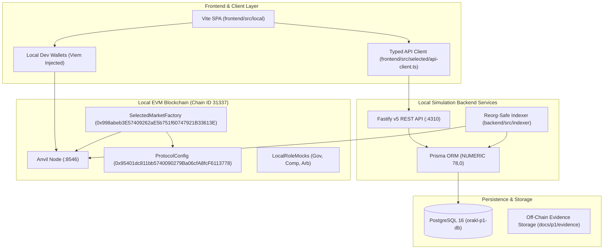

# ORAKL P1 Selected Architecture & Protocol Specification

## 1. System Overview

The **ORAKL P1** protocol is a decentralized, optimistic prediction market and oracle platform built on EVM-compatible networks. The architecture implements a strictly bounded local simulation environment designed for deterministic verification, atomic event indexing, remainder-free multi-challenger dispute resolution, and verifiable off-chain evidence anchoring.

---

## 2. Component Architecture

### 2.1 Smart Contract Layer
- [`SelectedMarketFactory.sol`](file:///home/pupulion/orakl/contracts/src/SelectedMarketFactory.sol): Core contract managing permissionless market creation, YES/NO predictions, outcome proposals, multi-challenger stake tranches, dispute resolution, and claim distribution.
- [`ProtocolConfig.sol`](file:///home/pupulion/orakl/contracts/src/ProtocolConfig.sol): Protocol configuration registry enforcing immutable exposure budgets, parameter management (`feeBps`, `creationBond`, `proposalBond`, `challengeBond`), time-locked release approvals (24-hour delay), and guardian emergency pause controls.
- [`LocalRoleMock.sol`](file:///home/pupulion/orakl/contracts/src/doubles/LocalRoleMock.sol): Test fixture simulating 2-of-2 multisig execution for `governance`, `complianceApprover`, and `arbitrator` roles.

### 2.2 Reorg-Safe Indexer
- [`run.ts`](file:///home/pupulion/orakl/backend/src/indexer/run.ts): Continuous block poller fetching logs from Anvil with dynamic batching and zero-confirmation local processing.
- [`project.ts`](file:///home/pupulion/orakl/backend/src/indexer/project.ts): Deterministic event projection engine folding contract events into PostgreSQL relational models. Enforces exact BigInt arithmetic, multi-challenger tranche accumulation, and `Outcome.INVALID` neutral mapping.
- [`reorg.ts`](file:///home/pupulion/orakl/backend/src/indexer/reorg.ts): Bounded reorganization detection and rollback engine (up to 4096 blocks). Safely purges orphaned blocks, predictions, challenges, and re-folds canonical events.

### 2.3 Fastify REST API
- [`server.ts`](file:///home/pupulion/orakl/backend/src/api/server.ts): Fastify v5 HTTP server binding strictly to `127.0.0.1:4310`. Exposes 18 versioned endpoints under `/api/v1/`.
- Standardized Error Envelopes ([ADR-0012](file:///home/pupulion/orakl/docs/adr/0012-centralized-fastify-error-handling.md)): Formats all application and validation errors into uniform `{ error: { code, message }, statusCode, requestId }` structures, scrubbing internal secrets and SQL details.
- Synchronization Metadata ([ADR-0007](file:///home/pupulion/orakl/docs/adr/0007-api-freshness-and-reorg-metadata.md)): Injects current block height, block hash, and sync lag status on all market reads.

### 2.4 Selected Frontend Client
- [`main.ts`](file:///home/pupulion/orakl/frontend/src/local/main.ts): Single-page application built with Vite and TypeScript. Renders live market listings, dispute status ladders, and protocol health indicators.
- [`api-client.ts`](file:///home/pupulion/orakl/frontend/src/selected/api-client.ts): Fully typed backend API client handling BigInt financial parsing, chain ID gating, and lag warnings.
- [`evidence.ts`](file:///home/pupulion/orakl/frontend/src/selected/evidence.ts): Off-chain RFC 8785 JSON canonicalizer and Keccak-256 evidence commitment verifier ([ADR-0003](file:///home/pupulion/orakl/docs/adr/0003-rfc8785-canonical-evidence-profile.md)).

---

## 3. Financial & Mathematical Invariants

The protocol strictly enforces mathematical solvency across contracts, indexer models, and API interfaces:

### Invariant A: Total Financial Solvency (Conservation of Collateral)
At all blocks $t$, the contract balance must equal or exceed aggregate protocol liabilities:
$$V_{\text{contract}} \ge L_{\text{participant}} + L_{\text{bond}} + L_{\text{fee}}$$
Where:
- $L_{\text{participant}} = \sum \text{unclaimed winning payouts} + \sum \text{unclaimed refunds}$
- $L_{\text{bond}} = \sum K_{\text{creation}} + \sum P_{\text{proposal}} + \sum C_{\text{challenge}}$
- $L_{\text{fee}} = \sum \text{accrued protocol fees}$

### Invariant B: Disjoint Liability Pools
No cross-subsidization between liabilities. Bond liabilities cannot be used to pay participant rewards or protocol fees, and participant collateral cannot be used to pay creator or challenger bonds.

### Invariant C: M1 Remainder-Free Challenge Stake Entitlement
In a disputed market resolved in favor of challengers, the total proposal bond $P$ is distributed among challengers strictly in proportion to their deposited stake:
$$\text{Entitlement}(C_i) = C_i + \left\lfloor \frac{P \cdot (S_{i-1} + C_i)}{S} \right\rfloor - \left\lfloor \frac{P \cdot S_{i-1}}{S} \right\rfloor$$
Where $S = \sum_{j=1}^m C_j$ is the total challenge stake, and $S_{i-1} = \sum_{j=1}^{i-1} C_j$ is the prefix sum before challenger $i$.
**Zero-Dust Theorem**: The sum of distributed shares exactly equals $P$, with zero residual dust or rounding loss:
$$\sum_{i=1}^m \left( \left\lfloor \frac{P \cdot S_i}{S} \right\rfloor - \left\lfloor \frac{P \cdot S_{i-1}}{S} \right\rfloor \right) = \left\lfloor \frac{P \cdot S}{S} \right\rfloor - \left\lfloor \frac{P \cdot 0}{S} \right\rfloor = P$$

### Invariant D: Neutral Outcome Zero-Fee & Zero-Slashing Invariant
If a market resolves to `INVALID` or is cancelled:
1. Protocol fee deduction is strictly zero ($\text{feeBps} = 0$).
2. Every participant entitlement equals $100\%$ of deposited principal: $\text{Refund}(u) = \text{Deposit}_{\text{YES}}(u) + \text{Deposit}_{\text{NO}}(u)$.
3. Proposer bond $P$ returns in full to proposer: $\text{Entitlement}(P) = P$.
4. Challenger stakes $C_i$ return in full to challengers: $\text{Entitlement}(C_i) = C_i$.
5. Creator bond $K$ returns in full to creator: $\text{Entitlement}(K) = K$.

### Invariant E: Refundable Creator Bond Invariant ($F = 0$)
Creator deposit $K$ is recorded strictly as a refundable liability. Zero nonrefundable creation fee is deducted ($F = 0$). $K$ returns to creator upon terminal resolution or cancellation ([ADR-0010](file:///home/pupulion/orakl/docs/adr/0010-refundable-creator-bond-zero-creation-fee.md)).

---

## 4. Bounded Reorganization Strategy

The protocol indexer tracks block hash ancestry up to 4096 blocks ([ADR-0002](file:///home/pupulion/orakl/docs/adr/0002-bounded-reorg-rollback-strategy.md)):
1. **Ancestry Check**: On every ingestion cycle, the indexer checks whether `parentHash` of the incoming block matches the cached hash of `currentBlock - 1`.
2. **Atomic Rollback**: If a fork divergence is detected, the indexer begins an interactive PostgreSQL transaction with a 60-second timeout, removes all blocks, events, predictions, and dispute tranches back to the common ancestor, and rewinds the checkpoint.
3. **Idempotent Replay**: Canonical blocks are ingested in order, reconstructing aggregate pool counters and multi-challenger tranches with zero duplicate records.
