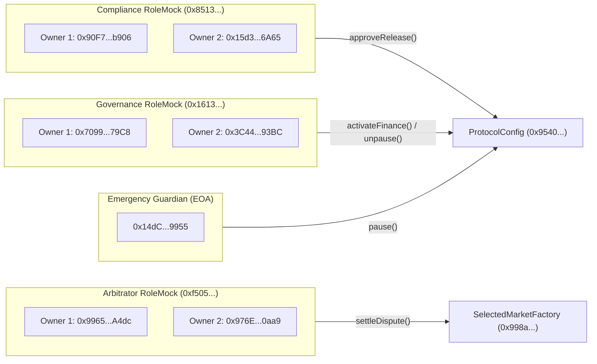

# ORAKL P1 Local Deployment & Verification Specification

This document details the deployment parameters, runtime code identity, immutable slot layout, and independent verification procedures for the **ORAKL P1** selected protocol fixture on Chain ID 31337.

---

## 1. Local Deployment Manifest

The canonical deployment manifest is recorded in:
- [`frontend/public/deployments/local-selected.json`](file:///home/pupulion/orakl/frontend/public/deployments/local-selected.json)
- [`backend/deployments/local-selected.json`](file:///home/pupulion/orakl/backend/deployments/local-selected.json)

```json
{
  "schemaVersion": 1,
  "status": "LOCAL_SIMULATION",
  "mode": "local-selected",
  "safety": {
    "publicDeployment": false,
    "productionApproval": false,
    "realFunds": false,
    "note": "Isolated Anvil development fixture. Not QIE Testnet, not QIE Mainnet, not an approved release."
  },
  "network": {
    "name": "ORAKL Local Selected (Anvil)",
    "chainId": 31337,
    "rpcUrl": "http://127.0.0.1:8546",
    "nativeSymbol": "ETH",
    "nativeDecimals": 18
  }
}
```

---

## 2. Deployed Contract Addresses & Runtime Code Verification

| Contract | Address | Start Block | Runtime Code Hash (Keccak-256) |
| :--- | :--- | :--- | :--- |
| **`ProtocolConfig`** | `0x95401dc811bb5740090279Ba06cfA8fcF6113778` | 539 | `0x8b23e01f56b37df9fa8973e4620feb21a1c6b469f277389a9816d9f0a8213e73` |
| **`SelectedMarketFactory`** | `0x998abeb3E57409262aE5b751f60747921B33613E` | 540 | `0xa0faea73b545bc721585256bb06d99a8f94dc3aa2ebdff14a52d1a207f528005` |
| **`LocalRoleMock` (Gov)** | `0x1613beB3B2C4f22Ee086B2b38C1476A3cE7f78E8` | 536 | *N/A (Test Mock)* |
| **`LocalRoleMock` (Comp)** | `0x851356ae760d987E095750cCeb3bC6014560891C` | 537 | *N/A (Test Mock)* |
| **`LocalRoleMock` (Arb)** | `0xf5059a5d33d5853360d16c683c16e67980206f36` | 538 | *N/A (Test Mock)* |

### Runtime Bytecode Immutable Patching
Because Solidity compiler embeds immutable values directly into runtime bytecode, [`verifyRuntimeCode`](file:///home/pupulion/orakl/scripts/p1/lib.mjs) extracts immutable references from compiler metadata (`contracts/out/SelectedMarketFactory.sol/SelectedMarketFactory.json`) and validates that the on-chain deployed bytecode matches the compiler template when patched with:
1. `protocolConfig` address (`0x95401dc811bb5740090279Ba06cfA8fcF6113778`)
2. `pilotExposureBudget` ($100\text{ ETH}$)
3. `globalExposureBudget` ($300\text{ ETH}$)
4. `arbitratorExposureBudget` ($200\text{ ETH}$)

---

## 3. Protocol Configuration & Economic Parameters

The deployed configuration enforces:
- **Protocol Fee (`feeBps`)**: `200` ($2.0\%$). Accrues only on successful binary settlements; strictly $0\%$ on `INVALID` or cancelled markets.
- **Creation Bond (`creationBond`)**: $1.0\text{ ETH}$ ($10^{18}\text{ WEI}$). Fully refundable to market creator upon terminal resolution or cancellation ([ADR-0010](file:///home/pupulion/orakl/docs/adr/0010-refundable-creator-bond-zero-creation-fee.md)). Nonrefundable creation fee $F = 0$.
- **Proposal Bond (`proposalBond`)**: $10.0\text{ ETH}$ ($10 \times 10^{18}\text{ WEI}$). Deposited by outcome proposer. Forfeited to challengers on reversal; returned on affirmation or neutral resolution.
- **Challenge Bond (`challengeBond`)**: $1.0\text{ ETH}$ ($10^{18}\text{ WEI}$). Minimum stake required to register a dispute tranche.
- **Pool Cap (`poolCap`)**: $100.0\text{ ETH}$ per market.
- **Challenge Period**: 48 hours ($172,800\text{ seconds}$).
- **Arbitration Period**: 96 hours ($345,600\text{ seconds}$).

---

## 4. Local Role Mocks & Multisig Mechanics

All governance and arbitration operations are controlled by 2-of-2 multisig mocks simulating production Safe behaviour:



---

## 5. The 15 Independent Verification Checks

The [`scripts/p1/verify-local-deployment.mjs`](file:///home/pupulion/orakl/scripts/p1/verify-local-deployment.mjs) script independently queries the Anvil node, re-computes contract bytecode hashes, and asserts 15 explicit conditions:

1. **`manifest-safety`**: Asserts `status === LOCAL_SIMULATION`, `publicDeployment === false`, `productionApproval === false`.
2. **`factory-config-linkage`**: Confirms bidirectional pointer consistency between factory and config.
3. **`financial-active`**: Asserts `financialActive === true` and `paused === false`.
4. **`release-digest`**: Validates keccak256 release digest calculation against live chain state.
5. **`activity-epoch`**: Confirms initial epoch is 0.
6. **`deployment-chain-id`**: Verifies `deploymentChainId === 31337`.
7. **`role-mocks`**: Confirms addresses of governance, compliance, and guardian.
8. **`parameters`**: Re-reads and asserts `feeBps == 200`, `poolCap == 100 ETH`, bonds.
9. **`exposure-caps`**: Verifies pilot (100 ETH), global (300 ETH), per-arb (200 ETH).
10. **`market-count`**: Confirms fresh factory starts with 0 markets.
11. **`runtime-code-hash`**: Compares live bytecode hashes against manifest.
12. **`runtime-immutable-patch`**: Verifies factory runtime matches compiler artifact when patched with immutables.
13. **`runtime-immutable-patch-config`**: Verifies config runtime matches compiler artifact when patched with immutables.
14. **`artifact-identity`**: Confirms SHA-256 hash of compiler artifacts and ABIs match manifest.
15. **`candidate-abi`**: Confirms full function and event selector parity.
