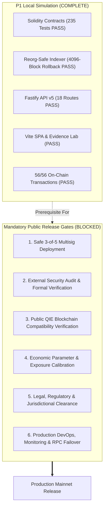

# ORAKL Protocol Production Release Blockers

**Release Status**: `P1 LOCAL E2E COMPLETE — PUBLIC RELEASE BLOCKED`
**Simulation Verdict**: `LOCAL_SIMULATION_VERIFIED; PRODUCTION_READINESS_NOT_VERIFIED`
**Target Environment**: Isolated Local Simulation (Chain ID 31337)

---

## 1. Executive Statement

Execution of all 11 implementation tickets, passing 235 contract tests, 93 backend tests, 82 frontend tests, and 56 end-to-end automated transactions demonstrates mathematical solvency and architectural correctness **strictly within the local Anvil simulation environment**.

**This milestone does NOT constitute approval for mainnet deployment, real-funds custody, or public release.**

The following six prerequisite blocker categories must be formally resolved, executed, and signed off before any production deployment or activation may occur.

---

## 2. Release Blocker Inventory

---

### Blocker 1: Production Safe 3-of-5 Multi-Signature Governance
- **Current State**: Uses disposable [`LocalRoleMock.sol`](file:///home/pupulion/orakl/contracts/src/doubles/LocalRoleMock.sol) test contracts on Anvil.
- **Production Requirement**:
  - Deploy verified Safe v1.4.1 contracts with 3-of-5 threshold for `governance`, `complianceApprover`, and `arbitrator`.
  - Signers must be geographically distributed keyholders utilizing hardware security modules (HSMs) or hardware wallets (Ledger/Trezor).
  - Enforce time-lock contracts with a minimum 48-hour timelock for governance parameter upgrades.

---

### Blocker 2: Independent Third-Party Security Audit
- **Current State**: Verified via internal invariant tests (`OraklInvariant.t.sol`), fuzzing (2048 runs/test), and Matt Pocock skills.
- **Production Requirement**:
  - Engagement with a Tier-1 smart contract audit firm (OpenZeppelin, Trail of Bits, Spearbit, or ConsenSys Diligence).
  - Formal verification of Invariant C (remainder-free telescopic challenger distribution) and Invariant A (conservation of collateral).
  - Remediation and public verification of all Critical, High, and Medium findings.

---

### Blocker 3: Public QIE Blockchain EVM Compatibility Verification
- **Current State**: Executed exclusively on Anvil (Chain ID 31337).
- **Production Requirement**:
  - Verification of QIE EVM gas schedule, state trie behavior, and RPC rate limits on QIE Testnet.
  - Validation of transaction finality depth (determining safe confirmation thresholds for the indexer on QIE).
  - Deployment rehearsal with real gas fees, nonce management, and network latency.

---

### Blocker 4: Production Economic Modeling & Parameter Calibration
- **Current State**: Fixed local values ($1\text{ ETH}$ creation bond, $10\text{ ETH}$ proposal bond, $1\text{ ETH}$ challenge tranche, $2\%$ fee).
- **Production Requirement**:
  - Quantitative economic modeling of dispute attack vectors (griefing costs, sybil challenge costs, capital efficiency).
  - Calibration of exposure budgets ($100\text{ ETH}$ pilot, $300\text{ ETH}$ global) based on market demand and insurance reserves.
  - Formal sign-off on non-refundable vs refundable bond structures by protocol stakeholders.

---

### Blocker 5: Legal & Regulatory Compliance
- **Current State**: Engineering simulation only.
- **Production Requirement**:
  - Legal review of prediction market mechanics under target regulatory jurisdictions (e.g. CFTC, MiCA, national gaming laws).
  - Formal Terms of Service, Privacy Policy, and restricted jurisdiction geofencing implementation.
  - Entity structuring for governance and arbitration operational bodies.

---

### Blocker 6: Production DevOps, High Availability & Monitoring
- **Current State**: Single local PostgreSQL container and in-process Node.js runners.
- **Production Requirement**:
  - High-availability PostgreSQL cluster with automated WAL archiving, point-in-time recovery (PITR), and read replicas.
  - Redundant RPC failover endpoints with automatic round-robin health checking.
  - 24/7 incident response alerting (Prometheus/Grafana + PagerDuty) tracking contract balance divergence, indexer block lag $> 10$ blocks, and unhandled 500 errors.
