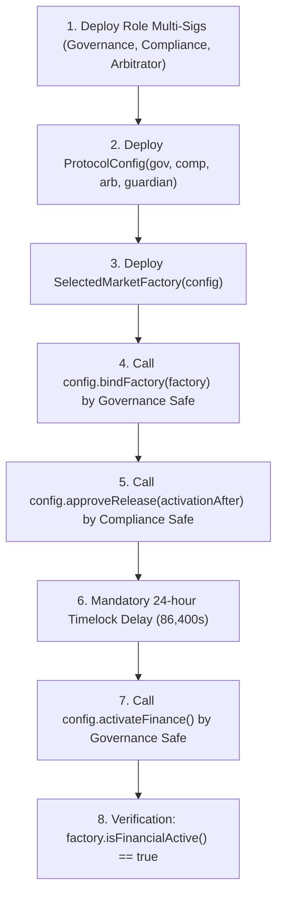

# ORAKL Protocol — Deployment Constraints & Preconditions

- **Document ID**: `ORAKL-P2-DEP-001`
- **Date**: 2026-11-01
- **Status**: `MANDATORY DEPLOYMENT PRECONDITIONS`

---

## 1. Smart Contract Deployment Order & Binding Sequence

---

## 2. Mandatory Pre-Deployment Constraints

1. **EVM Version Enforced**: Must never compile for `cancun` on QIE target networks. Pinned to `paris`.
2. **Cold Wallet Multisig Ownership**:
   - `Governance` Safe must possess 5 distinct signers with threshold 3.
   - `Compliance` Safe must possess 5 distinct signers with threshold 3.
   - No overlap greater than 1 signer across role sets to maintain institutional separation.
3. **Immutable Factory Binding**:
   - Once `ProtocolConfig.bindFactory(factory)` is invoked, the binding is irreversible. Factory replacement requires a new deployment cycle and liquidity migration.
4. **Mandatory Timelock**:
   - `activationAfter` must be at least `block.timestamp + 86400`. The contract enforces this requirement on-chain; premature activation reverts with `DelayNotElapsed()`.
5. **No Public Key Ingestion**:
   - Signer keys must remain on secure hardware modules (Ledger, Trezor, Safe CLI).
