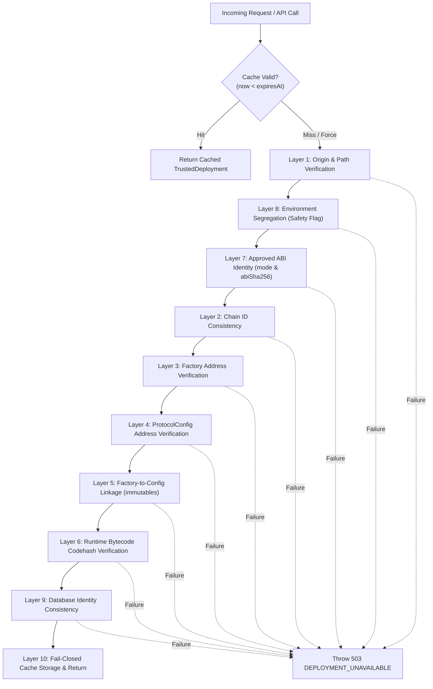

# ORAKL Protocol — Deployment Identity Trust Model & Layered Validation

- **Document ID**: `ORAKL-P2-TRUST-MODEL-001`
- **Date**: 2026-11-01
- **Status**: `IMPLEMENTED & VERIFIED SPECIFICATION`

---

## 1. Overview & Threat Defense

In decentralized prediction market systems, off-chain service layers (e.g. metadata ingestion, evidence storage, and indexing services) must establish strict cryptographic and architectural binding to the authoritative on-chain contracts. A critical vulnerability arises if the service relies on self-referential or client-supplied contract addresses to authenticate transactions or verify evidence.

To eliminate this vector, ORAKL implements a **10-Layer Deployment Validation Pipeline** in `backend/src/api/server.ts` via `resolveTrustedDeployment()`.



---

## 2. The Deployment Validation Pipeline & Independent Trust Anchor

Manifest content must **not** self-establish the trusted runtime codehash or ABI identity. Off-chain services must validate declared manifest artifacts against an independently approved Trust Anchor (`backend/src/evidence/trust-anchor.ts`).

| Layer | Validation Stage | Failure Condition | Security Defended |
| :--- | :--- | :--- | :--- |
| **Layer 1** | **Origin & Path Verification** | Manifest file missing, unreadable, or invalid path | File tampering, arbitrary file injection |
| **Layer 2** | **Chain ID Consistency** | `manifest.network.chainId !== config.chainId` | Cross-chain replay or network mismatch |
| **Layer 3** | **Factory Address Verification** | Malformed hex or zero address (`0x0...0`) | Unset or null factory address |
| **Layer 4** | **ProtocolConfig Address Verification** | Malformed hex or zero address (`0x0...0`) | Unbound configuration contract |
| **Layer 5** | **Factory-to-Config Linkage** | Factory's `immutableAssignment[0]` mismatch with `protocolConfig` | Rogue factory bound to unauthorized configuration |
| **Layer 6** | **Runtime Bytecode Codehash Verification** | Missing codehash or mismatch against expected codehash | Surrogate / proxy contract masquerading as factory |
| **Layer 7** | **Approved ABI Identity** | `mode !== "local-selected"` or missing `abiSha256` | Incompatible or legacy ABI spoofing |
| **Layer 7b** | **Independent Trust Anchor Enforcement** | Manifest declared `abiSha256` or `runtimeCodeKeccak256` does not match approved trust anchor | Self-referential or forged manifests injecting unapproved code |
| **Layer 8** | **Environment Segregation** | `status !== "LOCAL_SIMULATION"` or `safety.publicDeployment === true` | Public mainnet/testnet configurations loaded into dev environment |
| **Layer 9** | **Database Identity Consistency (FAIL CLOSED)** | DB query fails (outage/timeout) or Prisma DB `contractDeployment` record has differing address | Database outage, manifest desynchronization, rogue deployment insertion |
| **Layer 10** | **Fail-Closed Enforcement** | Any layer fails or throws | Complete rejection (503 HTTP status) without fallback |

---

## 2.1 Deployment Verification Gate (`scripts/p2/verify-deployment.mjs`)

To prevent false-positive verifications when RPC endpoints are offline, the deployment verification tool supports explicit operational modes:

1. **`artifact-only` Mode**:
   - Validates local JSON manifest structure, safety boundaries, immutable linkages, and compiled Foundry artifact ABI sha256 hashes (`contracts/out/SelectedMarketFactory.sol/SelectedMarketFactory.json`).
   - Does **not** perform network requests.
   - Outputs: `STATUS: ONCHAIN_UNVERIFIED`.
   - Explicitly does **not** claim full deployment verification pass.
2. **`onchain-required` Mode**:
   - Mandatory RPC connectivity check. If RPC is offline, unreachable, or errors, exits **non-zero** immediately.
   - Enforces live `eth_chainId` matching manifest chain ID.
   - Enforces nonempty on-chain bytecode (`eth_getCode !== "0x"`).
   - Enforces on-chain runtime codehash (`keccak256(bytecode)` matching approved artifact).
   - Enforces live mutual contract linkage calls (`factory.protocolConfig()` and `config.factory()`).
   - Any failure exits non-zero (`process.exit(1)`). Full verification success is never reported if on-chain checks are skipped.

---

## 3. Strict Isolation of the `TRUSTED_FACTORY` Test Shortcut

In earlier iterations, `config.trustedFactory` allowed bypassing manifest reads during unit tests. To eliminate any security vulnerability in staging or production:
1. **Production & Non-Test Rejection**:
   `loadConfig()` strictly throws `SECURITY_ERROR: TRUSTED_FACTORY shortcut is forbidden outside NODE_ENV=test` if `TRUSTED_FACTORY` is set when `NODE_ENV !== "test"`.
2. **Explicit Test Opt-in Required**:
   `resolveTrustedDeployment()` throws 503 `DEPLOYMENT_UNAVAILABLE` unless both `process.env.NODE_ENV === "test"` and `config.allowTestFactoryOverride === true`.
3. **No Production Bypass**:
   Under all staging, public, and production configurations, every request is strictly bound to the 10-layer validated deployment manifest.

---

## 4. Authenticated Deployment Caching Architecture

### 4.1 Purpose & Risk Mitigation
Under high read/write volume, resolving file manifests from disk and querying database tables on every single HTTP endpoint request introduces latency and file I/O contention.

### 4.2 Cache Mechanics
1. **Cache Keying**:
   The cache key uniquely compounds the environment variables:
   ```typescript
   const cacheKey = `${config.chainId}:${config.deploymentManifestPath ?? "default"}:${config.trustedFactory ?? "none"}:${config.expectedFactoryCodehash ?? "none"}`;
   ```
2. **Freshness TTL**:
   Configurable via `DEPLOYMENT_CACHE_TTL_MS` (default: 5,000 ms). Within the TTL, requests reuse the in-memory verified `TrustedDeployment` object.
3. **Explicit Invalidation**:
   `invalidateDeploymentCache()` purges the cache map instantly upon contract migrations, tests, or hot-reloads.
4. **Resilience**:
   If an underlying file is temporarily altered or transiently locked during a request, an active valid cache entry safely serves the verified context until expiration.

---

## 5. Verification Evidence

The 10-layer pipeline, fail-closed database handling, and cache mechanics are validated by an automated test suite in `backend/test/deployment-trust.test.ts`:
- `passes all 10 layers for a valid local simulation manifest`: **PASS**
- `Layer 1: rejects when manifest file is missing or unreadable`: **PASS**
- `Layer 2: rejects when chainId does not match server config`: **PASS**
- `Layer 3 & 4: rejects when factory or protocolConfig address is zero or invalid`: **PASS**
- `Layer 5: rejects when immutable binding does not match protocolConfig`: **PASS**
- `Layer 6: rejects when factory runtime codehash does not match expected codehash`: **PASS**
- `Layer 6: accepts when factory runtime codehash matches expected codehash`: **PASS**
- `Layer 7: rejects when abiSha256 is missing or invalid`: **PASS**
- `Layer 8: rejects manifest with publicDeployment=true in local simulation mode`: **PASS**
- `caches trusted deployment and honors freshness TTL and invalidation`: **PASS**
- `Layer 9: fails closed on database outage during deployment verification`: **PASS**
- `Layer 9: fails closed on forged manifest when database record has different factory`: **PASS**
- `Layer 9: accepts when database record matches manifest factory and config`: **PASS**
- `Layer 9: fails closed when requireDbDeploymentRecord is true and record is missing`: **PASS**
- `Strict isolation: rejects trustedFactory when allowTestFactoryOverride is false`: **PASS**
- `Strict isolation: accepts trustedFactory when allowTestFactoryOverride is true in test environment`: **PASS**

All 16 test cases execute and pass deterministically.
