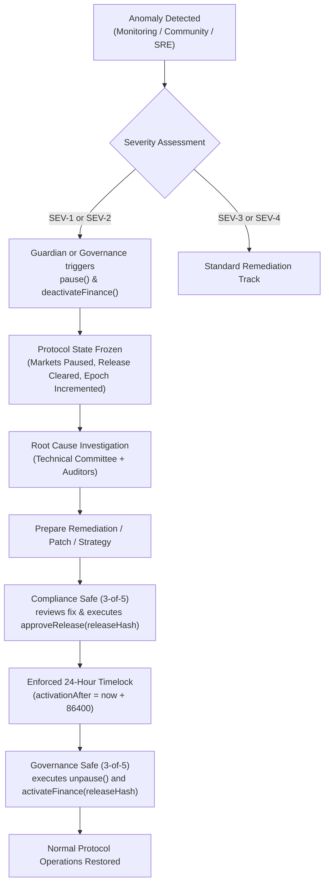

# ORAKL Protocol — Emergency Recovery Runbook

- **Document ID**: `ORAKL-P2-RUNBOOK-001`
- **Date**: 2026-11-01
- **Status**: `OPERATIONAL EMERGENCY PROCEDURES`

---

## 1. Incident Severity Classification

| Severity | Definition | Examples | Immediate Authorized Action |
| :--- | :--- | :--- | :--- |
| **SEV-1 (Critical)** | Direct threat to contract escrow or fund solvency | Reentrancy exploit, arithmetic underflow/overflow, broken invariant | Guardian / Governance `pause()` and `deactivateFinance()` immediately |
| **SEV-2 (High)** | Oracle or dispute resolution deadlock | Consensus failure on arbitrator, malicious challenge spam | Guardian `pause()`; convene Compliance and Governance Safes |
| **SEV-3 (Medium)** | RPC infrastructure degradation or indexer desync | QIE node RPC divergence, stale UI state | Shift RPC failover endpoints; no contract pause required unless data corruption verified |
| **SEV-4 (Low)** | Minor cosmetic or documentation issues | Frontend typo, non-critical telemetry failure | Standard patch cycle via issue tracker |

---

## 2. Emergency Response Workflow



---

## 3. Step-by-Step Execution Procedures

### Step 1: Emergency Freeze (Immediate Circuit Breaker)
**Actor**: Guardian Account or Governance Safe (3-of-5)  
**Target**: `ProtocolConfig.sol`  
**Calls**:
```solidity
// 1. Halt all market participation, resolution, and challenges
ProtocolConfig.pause();

// 2. Ensure financial operations cannot settle prematurely
ProtocolConfig.deactivateFinance();
```
**Effects**:
- `paused` flag is set to `true`.
- `financialActive` flag is set to `false`.
- `approvedRelease` is zeroed out (`bytes32(0)`).
- `epoch` is incremented.
- Factory prevents `contribute()`, `resolve()`, `challenge()`, and `settleDispute()`.

### Step 2: Anomaly Triage & Solvency Verification
**Actor**: Protocol Engineering Team  
1. Extract current state via on-chain read calls:
   - Total pool liabilities vs contract native balance: `address(factory).balance >= totalEscrow`.
   - List active disputed markets and dispute timestamps.
2. Verify invariant preservation:
   - Invariant A (Escrow conservation)
   - Invariant B (Zero-sum pool accounting)
   - Invariant C (Arbitrator cap constraints)

### Step 3: Compliance Re-Authorization
**Actor**: Compliance Safe (3-of-5)  
Once root cause analysis is complete and code/parameter changes are verified:
1. Generate the SHA-256 release digest `releaseHash` for the target deployment / parameter set.
2. Sign the transaction payload calling:
   ```solidity
   ProtocolConfig.approveRelease(releaseHash);
   ```
3. Submit 3 valid signatures in ascending order via Safe execution.
4. **Result**: `activationAfter` is set on-chain to `block.timestamp + 86400` (24 hours).

### Step 4: Mandatory 24-Hour Timelock Notice
**Actor**: Public & Ecosystem  
- The protocol remains in `paused` state during the entire 24-hour window.
- The 24-hour delay cannot be bypassed by any party, including Governance and Compliance.
- Market participants have full visibility of the pending resumption and release parameters.

### Step 5: Governance Unpause & Resumption
**Actor**: Governance Safe (3-of-5)  
Once `block.timestamp >= activationAfter`:
1. Governance signers assemble and sign the unpause transaction:
   ```solidity
   ProtocolConfig.unpause();
   ```
2. If financial operations are to be reactivated:
   ```solidity
   ProtocolConfig.activateFinance(releaseHash);
   ```
3. Submit 3 valid signatures in ascending order via Safe execution.
4. **Result**: Protocol resumes normal operations under the verified parameters.

---

## 4. Compromise Recovery Runbooks

### 4.1 Signer Key Compromise (Safe Signer Loss/Theft)
If 1 or 2 signers in the 3-of-5 Safe are compromised:
1. The remaining honest signers (at least 3) must immediately draft a Safe management transaction.
2. Call `Safe.swapOwner(prevOwner, compromisedOwner, newSecureOwner)` or `Safe.removeOwner(prevOwner, compromisedOwner, 3)`.
3. Gather 3 honest signatures and submit the transaction immediately.

### 4.2 Guardian Account Compromise
If the Guardian private key is leaked or abused:
1. The Governance Safe (3-of-5) possesses administrative authority to update or replace the Guardian role in `ProtocolConfig`.
2. Until rotated, the Guardian cannot unpause, cannot steal funds, and cannot approve releases (it can only trigger `pause()`).
