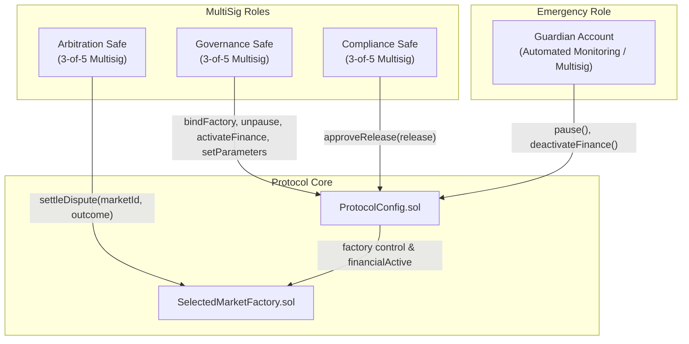

# ORAKL Protocol — Safe Multisig Governance Architecture

- **Document ID**: `ORAKL-P2-SAFE-ARCH-001`
- **Date**: 2026-11-01
- **Status**: `PROPOSED PRODUCTION GOVERNANCE SPECIFICATION`

---

> [!IMPORTANT]
> **TARGET ARCHITECTURE SPECIFICATION — LOCAL TEST FIXTURE DISCLOSURE**  
> This specification describes the proposed institutional governance architecture designed for future production deployment using Gnosis Safe 3-of-5 multi-signatures.  
> **Crucial Disclosures:**  
> 1. All local Anvil/Foundry tests execute against a custom test fixture ([`Safe3Of5.sol`](file:///home/pupulion/orakl/contracts/test/governance/Safe3Of5.sol)), **NOT** official or canonical Safe Global contracts.  
> 2. Official Safe Global contract integration into local tests is **BLOCKED** due to external dependency pinning constraints and differing Solc versions.  
> 3. No Safe contracts or hosted Safe infrastructure are currently deployed on QIE networks.

---

## 1. Governance Architecture Overview

The ORAKL protocol targets an institutional governance model eliminating single-party administrative keys by structuring privileged controls across three independent multi-signature domains (targeted as Safe 3-of-5 multisigs for production) alongside a dedicated rapid-response Guardian account.

---

## 2. Institutional Role Separation

### A. Governance Safe
- **Structure**: 5 distinct signers, threshold 3 (3-of-5).
- **Composition**: Technical maintainers, core foundation representatives, and community technical delegates.
- **Authority**:
  - `bindFactory(address facade)`: Binds factory contract instance irreversibly.
  - `setParameters(T.Parameters calldata next)`: Adjusts protocol parameters (triggers automatic pause & epoch transition).
  - `unpause()`: Resumes protocol operations following compliance re-approval.
  - `activateFinance(bytes32 release)`: Activates real-value financial operations once the 24-hour delay elapses.
- **Security Boundary**: Cannot activate finance without an approved digest from Compliance, and cannot bypass the 24-hour timelock.

### B. Compliance Safe
- **Structure**: 5 distinct signers, threshold 3 (3-of-5).
- **Composition**: Independent legal counsel, compliance officers, risk committee members, and external audit observers.
- **Authority**:
  - `approveRelease(bytes32 release)`: Authorizes a specific bytecode/parameter digest. Enforces deployment chain ID binding, codehash verification, and sets the immutable `activationAfter = block.timestamp + 24 hours`.
- **Security Boundary**: Cannot execute financial actions, cannot configure parameters, and cannot unpause the protocol directly.

### C. Arbitration Authority
- **Structure**: Dedicated 3-of-5 Multi-Sig or constrained dispute resolution council.
- **Authority**:
  - `settleDispute(uint256 id, Outcome outcome)`: Authoritative resolution of contested market outcomes (YES, NO, or INVALID).
- **Security Boundary**: Bound by per-arbitrator exposure caps (`perArbitratorUnresolvedCap = poolCap * 2`). Cannot access participant escrow directly; payouts are disbursed strictly according to protocol balance conservation formulas.

### D. Guardian Account
- **Structure**: Low-latency automated SRE account with multisig fallback.
- **Authority**:
  - `pause()`: Immediate emergency pause.
  - `deactivateFinance()`: Immediate financial deactivation.
- **Security Boundary**: Can ONLY pause/deactivate; CANNOT unpause, configure, withdraw, or approve releases.
