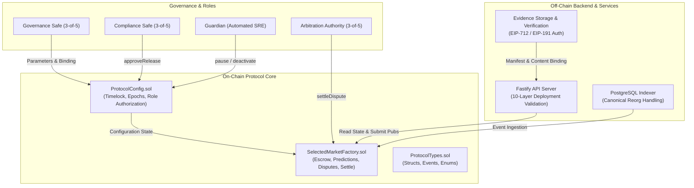

# ORAKL Protocol — Independent Security Audit Package

- **Package Version**: `ORAKL-P2-AUDIT-v1.0`
- **Baseline Git Commit**: `feature/orakl-p2-security-readiness`
- **Compiler Version**: Solidity `0.8.37` (pinned)
- **EVM Target**: `paris`
- **Date**: 2026-11-01
- **Status**: `AUDITOR HANDOFF READY — PUBLIC RELEASE BLOCKED`

> [!IMPORTANT]
> **AUDIT STATUS DISCLOSURE**  
> This documentation package is assembled to facilitate a comprehensive independent security audit by a third-party cybersecurity and smart contract auditing firm. **No external audit certification has yet been granted.** All public chain deployments and real-funds activations remain strictly blocked until formal audit completion and sign-off.

---

## 1. Audit Package Contents

This audit folder contains complete technical specifications, threat analyses, and operational handbooks:

| Document | Purpose & Key Topics |
| :--- | :--- |
| [`CONTRACT_INVENTORY.md`](./CONTRACT_INVENTORY.md) | Exhaustive catalog of in-scope smart contracts, source paths, bytecode hashes, compiler settings, and external dependencies. |
| [`THREAT_MODEL.md`](./THREAT_MODEL.md) | Formal STRIDE/DREAD threat modeling covering Sybil attacks, bribery, collusion, signature replay, reorg divergence, and RPC compromise. |
| [`SECURITY_INVARIANTS.md`](./SECURITY_INVARIANTS.md) | Mathematical and economic invariants governing fund solvency, escrow conservation, remainder-free fee distribution, and timelocks. |
| [`TRUST_ASSUMPTIONS.md`](./TRUST_ASSUMPTIONS.md) | Explicit documentation of trust boundaries for multisig signers, guardians, arbitrators, EVM consensus, and oracles. |
| [`KNOWN_LIMITATIONS.md`](./KNOWN_LIMITATIONS.md) | Documented operational constraints, EVM version limits, and off-chain service dependencies. |
| [`AUDITOR_HANDOFF.md`](./AUDITOR_HANDOFF.md) | Step-by-step reproduction guide to build, test, and verify the entire codebase locally in under 5 minutes. |
| [`RELEASE_BLOCKERS.md`](./RELEASE_BLOCKERS.md) | Definitive checklist of mandatory legal, technical, and operational gates required before mainnet deployment. |

---

## 2. In-Scope System Architecture

The ORAKL protocol consists of three primary architectural tiers:

---

## 3. Core Contact & Communication Protocol

- **Technical Inquiries**: ORAKL Protocol Core Engineering Team
- **Issue Tracking**: Local markdown tickets in `.scratch/p2-security-readiness/`
- **Vulnerability Disclosure**: Report all potential vulnerabilities to the lead protocol security engineer prior to disclosure.
