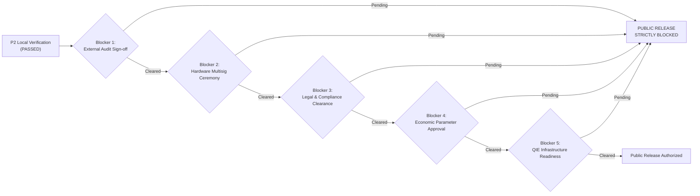

# ORAKL Protocol — Production Release Blocker Matrix

- **Document ID**: `ORAKL-P2-BLOCKERS-001`
- **Date**: 2026-11-01
- **Current Verdict**: `P2 LOCAL READINESS VERIFIED — PUBLIC RELEASE BLOCKED`

---

## 1. Release Blocker Summary

Before ORAKL smart contracts can be deployed to public QIE Testnet (1983) or Mainnet (1990) or activated with real-value financial custody, the following mandatory release blockers must be formally resolved and signed off.

---

## 2. Release Blocker Details & Resolution Criteria

| Blocker ID | Domain | Blocker Description | Resolution Criteria & Sign-off Authority | Current Status |
| :--- | :--- | :--- | :--- | :--- |
| **BLK-01** | **Security** | Independent Third-Party Smart Contract Security Audit | Formal audit engagement with a recognized Tier-1 blockchain security auditing firm; all Critical, High, and Medium findings resolved, verified, and signed off in a final published report. | **BLOCKING (Pending Engagement)** |
| **BLK-02** | **Governance** | Safe Multisig 3-of-5 Key Ceremony on Hardware Security Modules | Key generation ceremony across 5 independent geographically distributed signers for Governance Safe, Compliance Safe, and Arbitration Authority using dedicated hardware signers (Ledger / Trezor / HSM). No disposable keys. | **BLOCKING (Pending Key Ceremony)** |
| **BLK-03** | **Regulatory** | Legal & Compliance Classification Clearance | Formal legal opinion from specialized counsel in applicable operating jurisdictions confirming regulatory status of prediction markets, binary options, and tokenized escrow. | **BLOCKING (Pending Counsel Opinion)** |
| **BLK-04** | **Economics** | Formal Calibration & Approval of Production Parameters | Formal approval of protocol parameters (protocol fee `feeBps`, creation bond `creationBond`, proposal bond `proposalBond`, challenge bond `challengeBond`, pool caps `poolCap`, global unresolved cap `globalUnresolvedCap`). Current values are provisional engineering test fixtures. | **BLOCKING (Pending Economic Approval)** |
| **BLK-05** | **Infrastructure** | QIE Blockchain RPC & Node SRE Redundancy | Resolution of public testnet RPC connectivity (`rpc1testnet` port 443 refused), multi-region fallback RPC nodes, and automated node health monitoring. | **BLOCKING (Pending SRE Fix)** |
| **BLK-06** | **Operational** | Emergency Incident Response Runbook Rehearsal | Full dry-run rehearsal of emergency circuit breaker (`pause()`), compliance release re-approval (`approveRelease()`), and 24-hour timelock delay on a private staging testnet. | **BLOCKING (Pending Staging Drill)** |
| **BLK-07** | **Integration** | Official Safe Global Contracts Integration & QIE Deployment | Integration and on-chain verification of actual official Safe Global contracts rather than the local test fixture `Safe3Of5.sol`. Local integration is reported BLOCKED due to pinned dependency and compiler constraints. | **BLOCKING (Safe Integration Blocked)** |

---

## 3. Enforcement Policy

Under no circumstances may any engineer, developer, or agent:
- Deploy contracts to public QIE chains.
- Submit public chain transactions.
- Custody or risk user funds.
- Claim that ORAKL has completed an external security audit.

**All automated and local testing must remain strictly isolated on local Anvil Chain ID 31337.**
