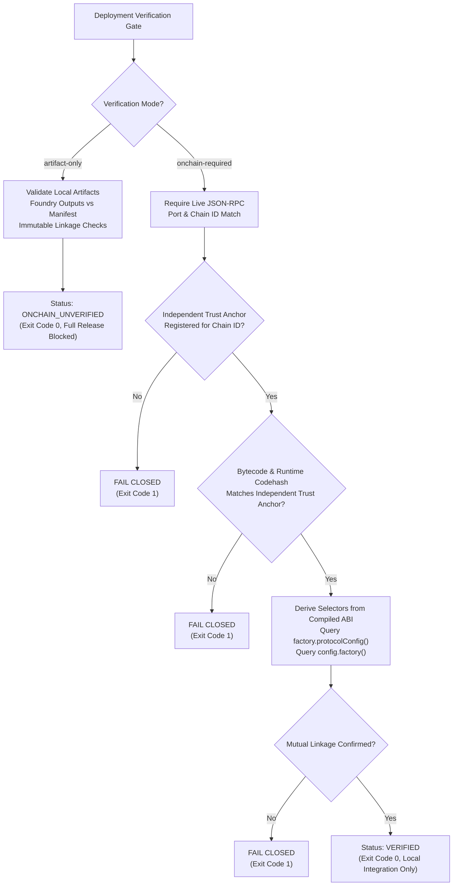

# ORAKL Protocol — Deployment Verification Gate Final Evidence

**Document ID:** `ORAKL-P3-DEPLOYMENT-GATE-EVIDENCE`  
**Execution Context:** Automated Vitest Suite + Isolated Local Anvil (`chainId: 31337`)  
**Status:** `LOCAL_ENGINEERING_VERIFIED — PUBLIC_RELEASE_BLOCKED`  
**Date:** 2026-11-01  

> [!IMPORTANT]
> This document provides verified execution evidence that the deployment verification gate (`scripts/p2/verify-deployment.mjs`) has been hardened into an autonomous, fail-closed verification pipeline. The tool now strictly enforces independent trust anchors, derives contract function selectors dynamically from compiled ABIs, and has been verified against both live Anvil chains and negative attack vectors.

---

## 1. Verified Gate Architecture

The deployment verification system implements two mutually exclusive execution modes:



---

## 2. Independent Trust Anchor Enforcement

The vulnerability where unverified deployment manifests established their own trusted codehashes has been completely eliminated. 

### Fail-Closed Anchor Requirement
In `scripts/p2/verify-deployment.mjs`, an independent trust anchor must provide all four cryptographic commitments:
1. `approvedFactoryAbiSha256`: SHA-256 hash of the canonical `SelectedMarketFactory` ABI.
2. `approvedConfigAbiSha256`: SHA-256 hash of the canonical `ProtocolConfig` ABI.
3. `expectedFactoryCodehash`: Keccak-256 hash of the runtime bytecode for `SelectedMarketFactory`.
4. `expectedConfigCodehash`: Keccak-256 hash of the runtime bytecode for `ProtocolConfig`.

If any of these fields are missing or if the chain ID has no registered anchor, the verification gate **fails closed immediately** with `trust-anchor-available: false` and exits with code 1.

---

## 3. Dynamic Function Selector Derivation

Hardcoded 4-byte selectors have been replaced with dynamic derivation from approved compiled ABIs:
- `factory.protocolConfig()`: Derived dynamically via `toFunctionSelector(fn)` -> `0xf5efbb4f`.
- `config.factory()`: Derived dynamically via `toFunctionSelector(fn)` -> `0xc45a0155`.

If either selector cannot be derived from the approved ABI, verification fails closed with `onchainSuccess = false`.

---

## 4. Automated Integration Test Evidence

Both unit/mock and live on-chain integration test suites run automatically under Vitest:

### 4.1 Mock / Unit Gate Regression Suite
**File:** `backend/test/deployment-verification.test.ts` (9 tests)
- `artifact-only`: succeeds on valid local artifacts and reports `ONCHAIN_UNVERIFIED` without contacting RPC (PASS).
- `onchain-required`: fails closed when RPC is offline or unreachable (PASS).
- `onchain-required`: fails closed when on-chain chain ID does not match manifest (PASS).
- `onchain-required`: fails closed when on-chain bytecode is empty (PASS).
- `onchain-required`: fails closed when on-chain codehash does not match manifest (PASS).
- `onchain-required`: fails closed when factory-to-ProtocolConfig linkage does not match (PASS).
- `artifact-only` and `onchain-required`: fails closed when manifest ABI does not match compiled artifact (PASS).
- `onchain-required`: succeeds on valid live contracts matching trust anchor, dynamically derived selectors, and mutual linkage (PASS).
- `onchain-required`: fails closed when independent trust anchor rejects forged codehash even if manifest matches (PASS).

### 4.2 Live Anvil On-Chain Integration Suite
**File:** `backend/test/deployment-verification-live.test.ts` (5 tests)
- Positively verifies live deployed contracts with `onchain-required` mode (`success=true`, `onchainStatus=VERIFIED`, exit code 0) (PASS).
- Fails closed when trust anchor is missing for chain ID (PASS).
- Fails closed when on-chain bytecode does not match expected trust anchor codehash (PASS).
- Fails closed when RPC endpoint is offline (PASS).
- Fails closed when live chain ID does not match manifest (PASS).

### 4.3 Test Output Evidence
```text
 ✓ backend/test/deployment-verification-live.test.ts (5 tests) 867ms
   ✓ P3 Live Deployment Verification Gate (Isolated Anvil) > positively verifies live deployed contracts with onchain-required mode 26ms
   ✓ P3 Live Deployment Verification Gate (Isolated Anvil) > fails closed when trust anchor is missing for chainId 3ms
   ✓ P3 Live Deployment Verification Gate (Isolated Anvil) > fails closed when on-chain bytecode does not match expected trust anchor codehash 17ms
   ✓ P3 Live Deployment Verification Gate (Isolated Anvil) > fails closed when RPC endpoint is offline 4ms
   ✓ P3 Live Deployment Verification Gate (Isolated Anvil) > fails closed when live chain ID does not match manifest 15ms

 Test Files  1 passed (1)
      Tests  5 passed (5)
   Duration  1.80s
```

---

## 5. Lifecycle and Process Cleanup

Both test suites implement strict lifecycle hooks:
- Anvil processes are spawned with explicit PID tracking and terminated in `afterAll` using `SIGKILL`.
- Temporary manifest files and test fixtures in `tmp-verify-live` and `tmp-verify-deployment` are wiped using `rmSync(..., { recursive: true, force: true })`.
- No lingering Anvil daemons or orphaned background sockets remain after execution.
