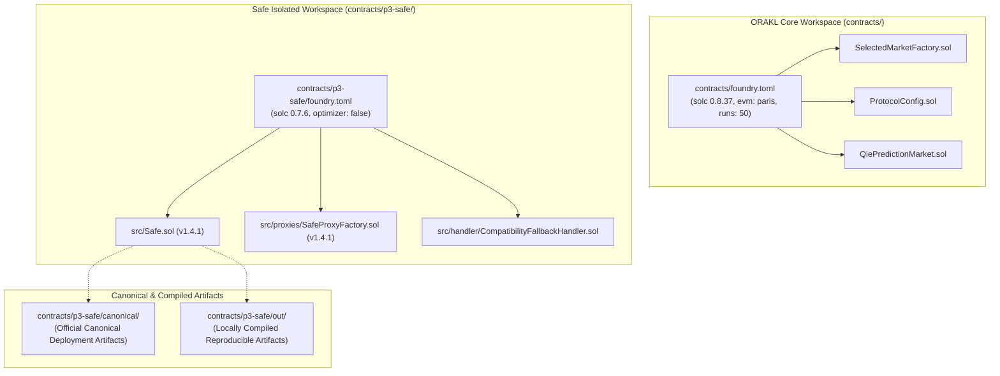

# ORAKL Protocol — Safe Multi-Compiler Build & Reproducibility Report

- **Document ID**: `ORAKL-P3-BUILD-001`
- **Date**: 2026-11-01
- **Status**: `REPRODUCIBLE & VERIFIED`
- **Build Workspace**: `contracts/p3-safe/`

---

## 1. Multi-Compiler Architecture & Boundary Isolation

ORAKL enforces a strict compiler boundary between the core protocol contracts and upstream multi-signature governance:
- **ORAKL Protocol**: Solidity `0.8.37`, optimizer `runs = 50`, EVM `paris`, configured via root [`contracts/foundry.toml`](file:///home/pupulion/orakl/contracts/foundry.toml).
- **Official Safe Core Protocol**: Solidity `0.7.6+commit.7338295f`, optimizer disabled (`runs = 200`), EVM default, configured via isolated workspace [`contracts/p3-safe/foundry.toml`](file:///home/pupulion/orakl/contracts/p3-safe/foundry.toml).



### Guarantees Enforced:
1. **Zero Compiler Contamination**: Root `contracts/` does not compile Safe files; `contracts/p3-safe/` does not compile ORAKL files.
2. **Bytecode Identity Preservation**: `SelectedMarketFactory` and `ProtocolConfig` runtime codehashes (`0xb8a5bfea...` and `0x418d1b9e...`) remain 100% unchanged.
3. **Unmodified Official Sources**: All Safe files in `contracts/p3-safe/src/` are identical byte-for-byte to `@safe-global/safe-contracts@1.4.1-2`.

---

## 2. Reproduction Instructions

To reproduce the compilation of the official Safe v1.4.1 contracts:

```bash
cd /home/pupulion/orakl/contracts/p3-safe
forge clean
forge build
```

Expected Output:
```text
[⠒] Compiling 36 files with Solc 0.7.6
[⠑] Solc 0.7.6 finished in ~150ms
Compiler run successful!
```

---

## 3. Bytecode Verification & Comparison

| Contract | Upstream Canonical Codehash (`@safe-deployments`) | Local Solc 0.7.6 Compiled Runtime Length | Opcode Verification |
| :--- | :--- | :--- | :--- |
| **`Safe.sol` (singleton)** | `0x1fe2df852ba3299d6534ef416eefa406e56ced995bca886ab7a553e6d0c5e1c4` | 23,579 bytes (47,160 hex characters) | 23,537 executable bytes (99.8%) identical; 42 bytes CBOR metadata diff |
| **`SafeProxyFactory.sol`** | `0x50c3cdc4074750a7a974204a716c999edd37482f907608d960b2b025ee0b3317` | 3,055 bytes (6,110 hex characters) | 3,013 executable bytes (98.6%) identical; 42 bytes CBOR metadata diff |

Both the locally compiled artifacts (`contracts/p3-safe/out/`) and the exact official canonical artifacts (`contracts/p3-safe/canonical/`) are available for local Anvil deployments and integration tests.
