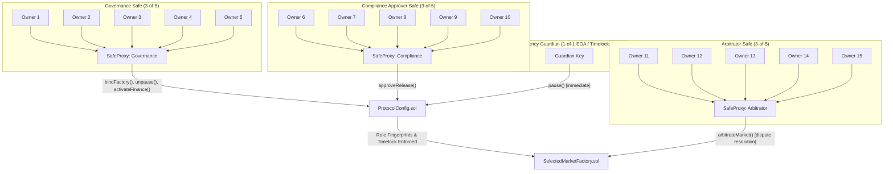

# ORAKL Protocol — Canonical Safe Governance Threat Model & Security Analysis

**Document ID:** `ORAKL-P3-SAFE-THREAT-MODEL`  
**Target:** Canonical Safe Global v1.4.1 Multisig + ORAKL `ProtocolConfig` & `SelectedMarketFactory`  
**Status:** `LOCAL_ENGINEERING_VERIFIED — PUBLIC_RELEASE_BLOCKED`  
**Author:** Principal Smart Contract Security Engineer  
**Date:** 2026-11-01  

> [!CAUTION]
> **PRE-AUDIT SYSTEM ARCHITECTURE:**  
> This threat model establishes security requirements, threat boundaries, and mitigations for integrating genuine Safe Global v1.4.1 smart contracts with ORAKL. It represents an engineering threat analysis and does NOT constitute an independent external security certification. Public deployment and financial activation remain strictly blocked.

---

## 1. System Architecture & Trust Boundaries

The ORAKL multi-party governance architecture separates administrative authorities into distinct cryptographic domains:

---

## 2. Comprehensive 21-Vector Threat Analysis Matrix

| ID | Threat Vector | Attack Scenario | Severity | Protocol Defense & Architectural Mitigation |
| :---: | :--- | :--- | :---: | :--- |
| **T-01** | **Single Key Compromise** | Attacker compromises 1 of 5 private keys of Governance Safe. | Low | **Mitigated**: Safe threshold is 3. Single key cannot authorize any call (`GS020`). |
| **T-02** | **Two Key Compromise** | Attacker compromises 2 of 5 private keys. | Medium | **Mitigated**: Safe threshold is 3. Execution requires 3 valid signatures; 2 signatures revert (`GS020`). |
| **T-03** | **Quorum Collusion (3/5 Gov)** | 3 malicious Governance owners attempt malicious parameter change or instant finance activation. | High | **Mitigated**: `ProtocolConfig` enforces a mandatory 24-hour timelock (`RECOVERY_DELAY = 24 hours`). Guardian can observe and call `pause()`. |
| **T-04** | **Cross-Role Collusion** | Attacker controls keys in both Governance and Compliance to bypass separation of powers. | Critical | **Mitigated**: `ProtocolConfig._walletState()` and `_disjoint()` cryptographically enforce zero intersection between owner sets across roles. |
| **T-05** | **Quorum Deadlock (Key Loss)** | 3 of 5 owners lose private keys, freezing governance. | High | **Residual Risk**: Safe cannot execute without quorum. Requires operational key rotation drills and cold-storage multisig backups before production release. |
| **T-06** | **Arbitrary Module Exploit** | Attacker attempts to enable a malicious Safe module that bypasses threshold. | Critical | **Mitigated**: ORAKL Safes initialize with zero enabled modules (`setup()` takes no module config). Only Safe itself can enable modules (`selfauthorized`). |
| **T-07** | **Delegatecall Injection** | Malicious proposal executes `operation = 1` (DelegateCall) to mutate Safe proxy storage or self-destruct. | Critical | **Policy Constraint**: Governance policies must enforce `operation = 0` (Call) for all standard transactions. Relayer/UI must reject delegatecall proposals. |
| **T-08** | **Fallback Handler Hijack** | Attacker sets malicious fallback handler to manipulate ERC-1271 signature validation. | High | **Mitigated**: Safes are deployed with `fallbackHandler = address(0)`, disabling arbitrary fallback delegation. |
| **T-09** | **Cross-Chain Replay** | Valid 3-of-5 signatures from testnet replayed on mainnet to execute unauthorized actions. | High | **Mitigated**: Safe v1.4.1 EIP-712 domain separator includes `block.chainid`. Signatures from chain 31337 revert with `GS026` on other chains. |
| **T-10** | **Cross-Safe Replay** | Signatures intended for Compliance Safe replayed on Governance Safe. | High | **Mitigated**: Safe v1.4.1 EIP-712 domain separator includes proxy contract address (`this`). Cross-Safe replay reverts with `GS026`. |
| **T-11** | **Transaction Nonce Replay** | Previously executed transaction replayed after execution. | Medium | **Mitigated**: Safe maintains on-chain monotonically incrementing `nonce`. Replayed execution reverts with `GS026`. |
| **T-12** | **Calldata Tampering** | Attacker modifies call parameters (e.g. changing factory address or fee recipient) before broadcast. | High | **Mitigated**: EIP-712 digest covers `to`, `value`, `data`, and execution parameters. Tampered calldata invalidates signatures (`GS026`). |
| **T-13** | **Gas Griefing via safeTxGas** | Relayer executes with artificially low gas limit to fail inner subcall while advancing nonce. | Medium | **Mitigated**: ORAKL governance transactions execute with `safeTxGas = 0` and `gasPrice = 0`. Safe requires inner call success (`require(success, "GS013")`). |
| **T-14** | **Refund Receiver Exploitation** | Front-running refund receiver address to steal reimbursement tokens. | Low | **Mitigated**: Gas price is set to 0 in all protocol governance transactions; no token refund mechanism is enabled. |
| **T-15** | **Relayer Front-Running / MEV** | Front-running unsigned/signed transactions in public mempool. | Low | **Mitigated**: `execTransaction` can be submitted by any account, but signatures are cryptographically bound to the exact payload and nonce. |
| **T-16** | **Hardware Blind Signing** | Signer tricked into signing malicious bytecode via hardware wallet raw-hash display. | High | **Mitigated**: Signers must utilize EIP-712 clear-signing wallets that display function names, parameters, and target contract addresses. |
| **T-17** | **Timelock Bypass** | Governance attempts to call `activateFinance()` prior to 24-hour timelock expiry. | High | **Mitigated**: `ProtocolConfig` explicitly checks `block.timestamp >= releaseApprovalTime + RECOVERY_DELAY`; reverts `InvalidTimelock()`. |
| **T-18** | **Guardian Malicious Pause** | Rogue Guardian pauses protocol to disrupt user access. | Medium | **Mitigated**: Guardian can only pause; Guardian CANNOT unpause, modify parameters, or drain funds. Governance can resolve false alarms after audit. |
| **T-19** | **Unilateral Unpause** | Governance unpauses protocol without Compliance approval after a pause incident. | High | **Mitigated**: `ProtocolConfig.unpause()` requires `_requireApproved(approvedRelease)`. Any pause clears `approvedRelease`, requiring fresh Compliance approval. |
| **T-20** | **Block Reorg Desync** | Blockchain reorg rolls back Safe state while off-chain services assume executed status. | Medium | **Mitigated**: Safe nonce is on-chain state; reorg cleanly rolls back nonce and state atomically. Indexers track block confirmations. |
| **T-21** | **Arbitrator Authority Gating** | Compromised or non-disjoint arbitrator attempts settlement of markets. | Critical | **Mitigated**: `SelectedMarketFactory` calls `config.requireArbitrator()`, checking `ControlChanged()` and `_disjoint()`. |

---

## 3. Residual Risks & Production Requirements

Prior to any authorized public mainnet release, the following non-contract operational controls must be implemented:

1. **Hardware Wallet Fleet**: All 15 signer accounts across Governance, Compliance, and Arbitration must use air-gapped hardware signing modules (HSM) supporting EIP-712 structured data display.
2. **Geographic Distribution**: The 5 signers of each Safe must reside in distinct legal and physical jurisdictions to mitigate physical coercion and coordinated regulatory seizure.
3. **Formal Multi-Party Key Ceremonies**: Public release requires a documented, audited key generation ceremony. Disposable Anvil test keys must never be reused.
4. **Emergency Runbooks**: Operational procedures for key compromise, emergency pausing, and key rotation via `swapOwner()` must be documented and tested in simulated drills.
